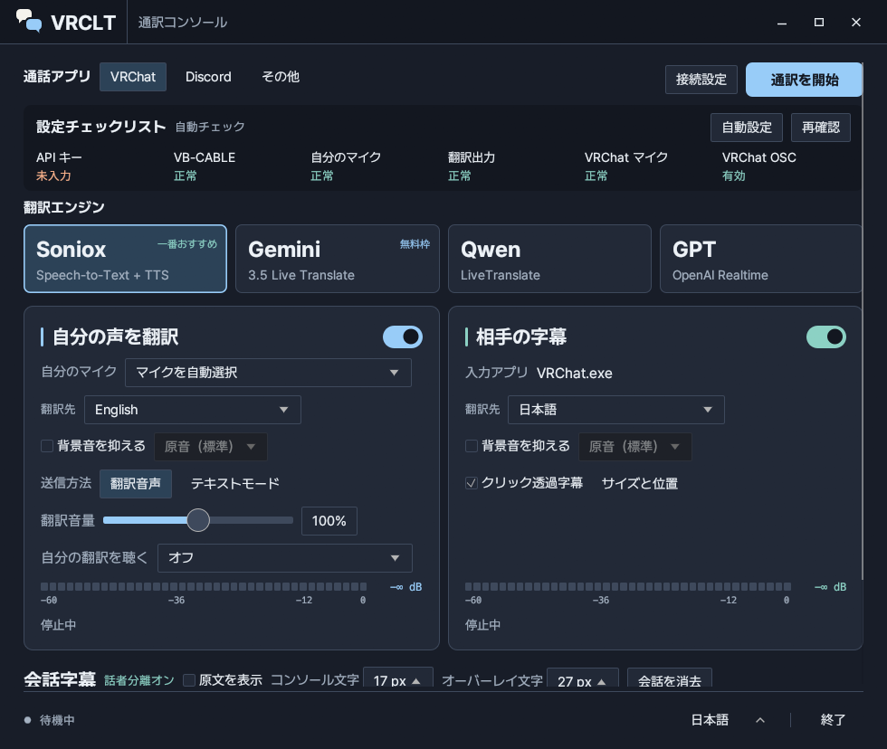
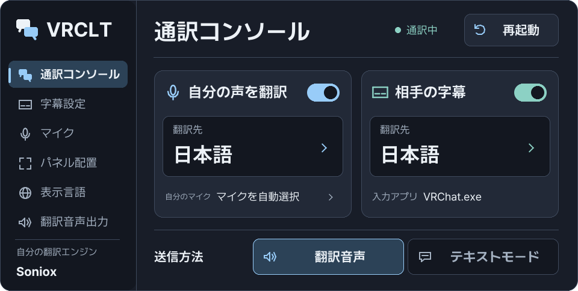

<picture>
  <source media="(prefers-color-scheme: dark)" srcset="docs/brand/logo-dark.svg">
  
</picture>

[English](README.md) | [한국어](README.ko.md) | [日本語](README.ja.md) | [简体中文](README.zh.md)

# VRCLT 2.0

VRChat と Discord 向けの Windows 用リアルタイム通訳アプリです。自分の声の翻訳と相手の字幕をひとつのネイティブ画面で操作できます。

**[Windows 版をダウンロード](https://github.com/VRCLT/VRCLT/releases/latest)** | [リリースノート](docs/releases/v2.0.0.md) | [ガイド](https://github.com/VRCLT/VRCLT/wiki)



## 使い始める

1. 旧版を終了して Windows x64 用 EXE を起動します。ZIP の場合は展開して `vrclt/vrclt.exe` を起動します。どちらも `%LOCALAPPDATA%\vrclt\config.yaml` にある設定と API キーを引き継ぎます。
2. 接続設定で翻訳エンジンを選び、API キーを入力します。話者を区別する会話には **Soniox**、無料枠で始めるには **Gemini 3.5 Live Translate** がおすすめです。**Qwen** と **GPT (OpenAI Realtime)** も選べます。料金と利用枠は各サービスでご確認ください。
3. マイク、字幕の対象アプリ、翻訳先の言語を選びます。設定チェックリストで接続を確認し、必要に応じて自動設定を使ってから通訳を開始します。

## 音声とテキスト

テキストモードは翻訳文を OSC で VRChat のチャットボックスに送ります。テキストと相手の字幕には VB-CABLE は不要です。翻訳音声を送る場合は出力を CABLE Input、通話アプリのマイクを CABLE Output にします。ヘッドホンで翻訳音声を確認し、音量を調整できます。

## 字幕と SteamVR

原文表示、文字サイズの変更、履歴の消去に対応しています。デスクトップ字幕はクリックを透過します。VR では手首を見るとメニューが表示されます。グリップでパネルを移動し、字幕板の下隅をトリガーでドラッグしてサイズを変更できます。SteamVR の起動設定で自動起動を切り替えられます。



## 音声オプション

入力ごとに DeepFilterNet3 (CPU) または Nemotron RE-USE (GPU) で背景音を抑えられます。GPU モデルは初回にダウンロードされます。Soniox では例文を録音して自分の音声を登録できます。

## ビルド

Windows x64、Rust stable MSVC、Visual Studio C++ ツール、CMake、libclang を使用します。

```powershell
./scripts/build_native.ps1 -Test
./scripts/package_release.ps1 -SkipBuild
```

[MIT](LICENSE) | [Third-party licenses](licenses)
