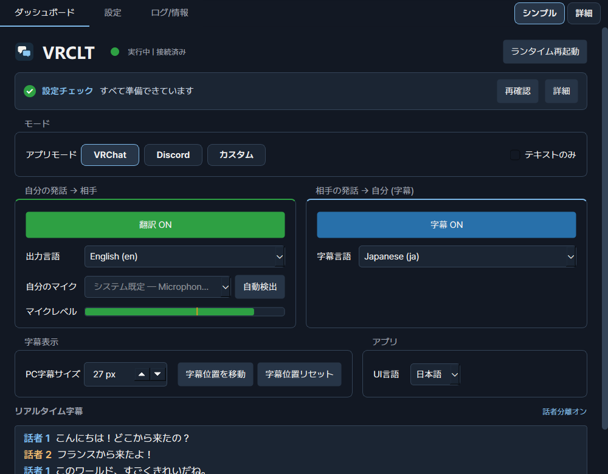
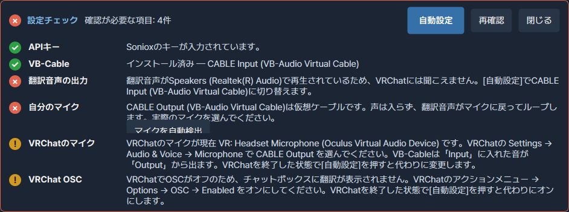
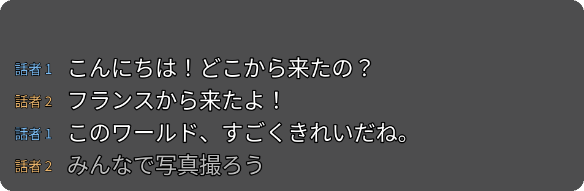
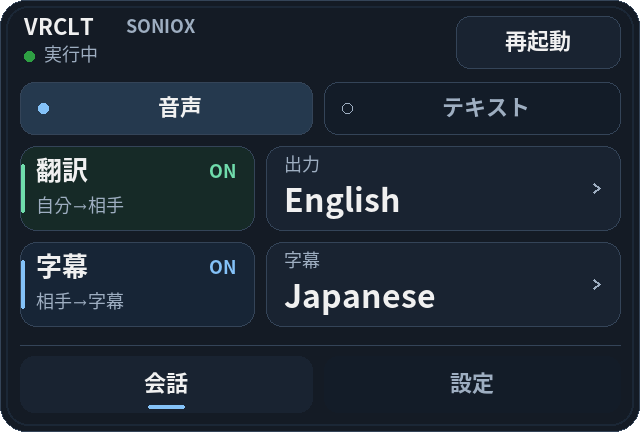
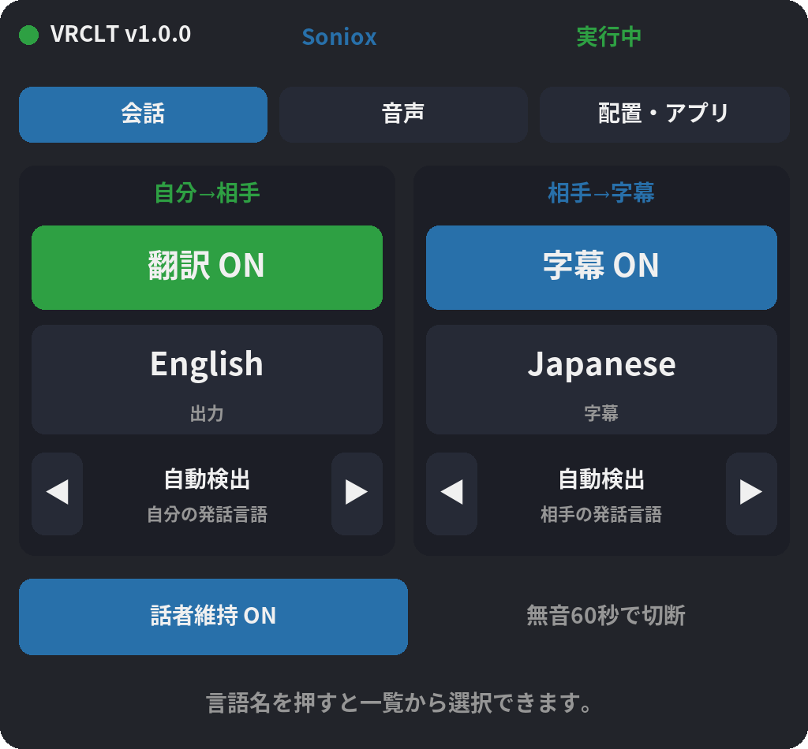

<div align="center">

<h1>
  <picture>
    <source media="(prefers-color-scheme: dark)" srcset="docs/brand/logo-dark.svg">
    
  </picture>
</h1>

<p><a href="https://vrclt.github.io/ja/">公式サイト</a></p>

### 自分の言葉で話せば、相手の言葉で届く。

Windows 向け **VRChat** / **Discord** リアルタイム音声翻訳とリアルタイム字幕。

[](https://github.com/VRCLT/VRCLT/releases/latest) [](https://github.com/VRCLT/VRCLT/releases) [](#要件) [](LICENSE)

[English](README.md) · [한국어](README.ko.md) · **日本語** · [中文](README.zh.md)

<br>



<br><br>

[**⬇ VRCLT をダウンロード**](https://github.com/VRCLT/VRCLT/releases/latest) &nbsp;·&nbsp; [クイックスタート](#クイックスタート) &nbsp;·&nbsp; [詳しいドキュメント](#インストール)

</div>

## VRCLT の特長

<table>
<tr>
<td width="50%" valign="top">

### 🎙️ あなたの声をそのまま翻訳

いつも通り話すだけ。VRCLT がリアルタイムで翻訳し、自然な翻訳音声を VRChat や Discord のマイクとして届けます。相手は自分の言葉であなたの声を聞けます。

</td>
<td width="50%" valign="top">

### 💬 リアルタイム字幕

相手の発話が SteamVR、デスクトップオーバーレイ、アプリ画面に字幕で表示されます。話者を区別できるエンジンでは話者番号も表示します。

</td>
</tr>
<tr>
<td width="50%" valign="top">

### ⚡ ワンクリック設定

設定チェックが足りないものを教えてくれます。**自動設定** は音声の経路、マイク選択、VRChat のマイクと OSC まで整え、**VB-Cableを自動インストール** は公式インストーラーを代わりに起動します。

</td>
<td width="50%" valign="top">

### 🥽 VR のためのアプリ

手首メニューと SteamVR ダッシュボードのページで VR の中から操作でき、字幕は目の前に浮かび、SteamVR と一緒に自動起動できます。

</td>
</tr>
<tr>
<td width="50%" valign="top">

### 💭 VRChat チャットボックス

原文と翻訳を OSC でチャットボックスに送ります。テキストのみモードでは自分の声はそのままに、翻訳テキストだけを加えます。

</td>
<td width="50%" valign="top">

### 🌐 4 つのエンジン、70 以上の言語

Google Gemini Live、Qwen3.8 LiveTranslate、OpenAI gpt-realtime-translate、Soniox から、料金・地域・音声・話者分離に合わせて選べます。

</td>
</tr>
</table>

## クイックスタート

1. [Releases](https://github.com/VRCLT/VRCLT/releases/latest) から `vrclt-v<version>-windows-x64.exe` を**ダウンロードして実行**します。インストールは不要です。
2. **API キーを入力します。** 既定のエンジンは Gemini です。[Google AI Studio](https://aistudio.google.com/apikey) でキーを作成し、**設定 → Gemini API キー** に貼り付けてください。ほかのエンジンは[翻訳エンジン](#翻訳エンジン)を参照してください。
3. **残りは設定チェックにお任せ。** VB-Cable がなければ **VB-Cableを自動インストール** を押し、VRChat を終了してから **自動設定** を押します。
4. **VRChat を起動して話すだけ。** 翻訳と字幕はダッシュボードか手首メニューで切り替えます。

<p align="center"></p>

## VR で

<p align="center">
<br><br>
&nbsp;&nbsp;

</p>

字幕は目の前に浮かび、手首メニューで翻訳・字幕・言語を切り替え、SteamVR ダッシュボードのページで言語、オーディオデバイス、パネル配置を扱います。

<details>
<summary><b>すべての機能</b></summary>

- ダッシュボード、設定、ログ/情報タブを備えた Windows ネイティブ UI
- アプリを開く、設定を開く、翻訳/字幕の切り替え、終了ができるトレイメニュー
- 送信側翻訳: 自分のマイク -> selected engine -> 翻訳音声 -> 対象アプリのマイク
- 受信側字幕: 対象アプリの音声 -> selected engine -> 翻訳字幕
- 4 つの翻訳エンジン: Google Gemini Live（既定）、Alibaba Qwen3.8 LiveTranslate、OpenAI gpt-realtime-translate、Soniox
- VRChat OSC チャットボックス、アバター OSC 制御、SteamVR 字幕、手首メニュー対応
- SteamVR ダッシュボード設定パネルと SteamVR 自動起動（スタートアップ/オーバーレイアプリ登録）対応
- 元の声をそのまま通し、OSC チャットボックスに翻訳テキストだけを追加する VRChat テキストのみモード
- Discord プロセス音声キャプチャと、VRChat 専用機能の自動無効化
- 現在音を出しているプロセスから選んで任意のアプリをキャプチャできるカスタムモード
- 原音送出は 48 kHz の元マイクストリームを直接使い、Gemini 翻訳用ストリームは別にリサンプリング
- GitHub Releases の更新通知と、API キー、保存済み言語リスト、UI 言語、ウィンドウを閉じる動作、選択したオーディオデバイスを保持する安全な設定リセット
- [VRCLT Releases](https://github.com/VRCLT/VRCLT/releases) からダウンロードできる Windows exe
- ユーザー設定の保存先: `%LOCALAPPDATA%\vrclt\config.yaml`

</details>

## インストール

### 要件

- Windows 11 推奨
- 選択したエンジンの API キー: Gemini、Qwen/DashScope、OpenAI、Soniox
- [VB-Audio Virtual Cable](https://vb-audio.com/Cable/)
- VR オーバーレイと手首 UI を使う場合は SteamVR
- VRChat チャットボックス/アバター制御を使う場合は VRChat OSC を有効化

### 1. vrclt をダウンロード

最新の Windows 実行ファイルは [VRCLT Releases](https://github.com/VRCLT/VRCLT/releases) からダウンロードできます。

次のような名前のファイルを使います。

```text
vrclt-v<version>-windows-x64.exe
```

リリース exe は設定を次の場所に保存します。

```text
%LOCALAPPDATA%\vrclt\config.yaml
```

API キーはこのファイルに平文で保存されます。

### 2. VB-Audio Virtual Cable をインストール

VRChat または Discord に翻訳音声をマイクとして受け取らせるには、VB-Audio Virtual Cable が必要です。

**いちばん簡単な方法:** ダッシュボードの **設定チェック** パネルで **VB-Cableを自動インストール** を押します。vrclt が公式サイト（www.vb-cable.com）からパッケージをダウンロードし、VB-Audio のデジタル署名を確認してから VB-Audio のインストーラーを開きます。Windows の確認を許可して **Install Driver** を押し、完了画面を閉じると、vrclt がデバイスを再読み込みして **自動設定** を続けます。VB-CABLE は VB-Audio の寄付制（donationware）ソフトウェアです（all participations are welcome）。

手動でインストールする場合:

1. [VB-Audio Virtual Cable](https://vb-audio.com/Cable/) から **VB-CABLE** をダウンロードします。
2. ダウンロードした ZIP ファイルを展開します。
3. `VBCABLE_Setup_x64.exe` を右クリックし、**管理者として実行**します。
4. **Install Driver** をクリックします。
5. `CABLE Input` / `CABLE Output` が表示されない場合は Windows を再起動します。

インストール後、Windows には次の 2 つの重要なデバイスが追加されます。

| デバイス | 意味 | 選択する場所 |
| --- | --- | --- |
| `CABLE Input` | 仮想ケーブルの再生/出力側 | vrclt の翻訳音声出力デバイス |
| `CABLE Output` | 仮想ケーブルの録音/マイク側 | VRChat または Discord のマイク |

実際のマイクは vrclt 側で選択します。翻訳音声を相手に届けるには、VRChat/Discord のマイクを実マイクではなく `CABLE Output` に設定してください。

### 3. Gemini API キーの取得方法

1. [Google AI Studio](https://aistudio.google.com/) を開き、Google アカウントでログインします。
   - Google アカウントがない場合は先に作成します。
2. 左サイドバー、またはページ上部の **Get API key** ボタンをクリックします。
   - [https://aistudio.google.com/apikey](https://aistudio.google.com/apikey) に直接移動しても構いません。
3. **Create API key** をクリックします。
4. API キーに関連付ける Google Cloud プロジェクトを選択します。
   - 既存プロジェクトがない場合は **Create API key in new project** を選ぶと自動作成されます。
5. 生成されたキー (`AIza...` で始まる文字列) をコピーします。
   - キー全体は一度しか表示されないため、安全な場所に保管してください。
6. コピーしたキーを `vrclt` の設定タブにある **API キー** 欄へ貼り付けるか、
   `config.yaml` の `gemini.api_key` に設定します。

> **注意**: Gemini API には、個人利用には十分な分単位リクエスト制限付き無料枠があります。
> API キーは他人と共有しないでください。`config.yaml` に平文で保存されるため、このファイルを公開リポジトリにコミットしないでください。

### 3b. 代替: Qwen API キー（Gemini を利用できない地域向け）

お住まいの地域で Google サービスを利用できない場合（例: 中国本土）、vrclt は
Gemini の代わりに **Alibaba Qwen3.8 LiveTranslate** を使えます。

1. Alibaba Cloud アカウントを作成し、**Model Studio** を有効化します。
   - 中国本土: [bailian.console.aliyun.com](https://bailian.console.aliyun.com/)
   - 国際（シンガポール）: [Alibaba Cloud Model Studio](https://www.alibabacloud.com/en/product/modelstudio)
2. API キー（DashScope キー、`sk-...` で始まる）を作成します。
   **キーはリージョンに紐づきます**: 本土（北京）のキーは `beijing`
   エンドポイントでのみ、国際キーは `intl` でのみ動作します。
3. vrclt の設定で **翻訳エンジン** を `qwen` にし、キーを
   **Qwen APIキー (DashScope)** に貼り付け、キーに合った **Qwenサーバー**
   （中国本土は `beijing`、それ以外は `intl`）を選択します。キーは
   `DASHSCOPE_API_KEY` 環境変数でも指定できます。
4. **QwenワークスペースID — `intl` では必須**: 国際（シンガポール）
   エンドポイントはワークスペース専用ドメイン経由でのみ提供されます。
   Model Studio コンソールのホームで左下のアイコンをクリックし、
   **Workspace Details** を開いて ID（`llm-7c72iiw36kd8****` のような形式）を
   コピーし、**QwenワークスペースID** 欄に貼り付けます。`beijing`
   エンドポイントは空のままで構いません（従来の共有 `dashscope` ドメイン）。
   参考: [Obtain the workspace ID](https://www.alibabacloud.com/help/en/model-studio/obtain-api-key-app-id-and-workspace-id)
5. 既定のモデル `qwen3.8-livetranslate-flash-realtime` は発話言語を自動検出し、
   話者を区別します。**Qwenモデル** を `qwen3.5-livetranslate-flash-realtime` に
   変更した場合のみ、**自分の発話言語** と **相手の発話言語** を設定します —
   Qwen 3.5 は発話言語を自動検出できません（下の「翻訳エンジン」セクションを参照）。

### 3c. Soniox の設定

1. [Soniox コンソール](https://console.soniox.com)でアカウントを作成し、ログインします。
2. **My First Project** または使用するプロジェクトを開き、**API Keys** でキーを作成します。
   [公式の開始ガイド](https://soniox.com/docs/stt/get-started)を参照してください。
   v1.0.0 は米国(US)サーバーを使用するため、リージョンを選べる場合は **US プロジェクト**を
   使用します。他リージョンへの切り替え設定は未対応です。[リージョン案内](https://soniox.com/docs/data-residency)
3. [Billing overview](https://console.soniox.com/org/billing/overview/) で API 残高を確認し、
   必要に応じてチャージします。[API 料金表](https://soniox.com/pricing)も確認してください。
   試用クレジットの有無や金額は、登録時のコンソールに表示される条件に従います。
4. vrclt の **設定 → 翻訳エンジン**で `soniox` を選び、**Soniox API キー**に貼り付けます。
   最初は認識モデル `stt-rt-v5`、TTS モデル `tts-rt-v2`、音声 `Daniel` の既定値を使います。
5. アプリモード、実際のマイク、翻訳音声の出力先を選び、設定を保存して再起動します。
   仮想マイクの接続は下の **初回起動設定**にある `CABLE Input` / `CABLE Output` の説明を参照してください。
6. ダッシュボードの **出力言語**は自分の発話の翻訳先、**字幕言語**は相手の発話を読む言語です。
   例えば日本語で話して韓国語の相手と会話するなら、出力を韓国語、字幕を日本語にします。
   **自分/相手の発話言語**は自動検出のまま、または日本語/韓国語を認識ヒントとして指定できます。

環境変数 `SONIOX_API_KEY` を使う場合は、アプリの Soniox API キー欄を空にし、
環境変数の設定後にアプリを完全に終了して起動し直します。手動設定には以下の
`config.yaml` を使います。GUI で設定した場合はファイル編集は不要です。

```yaml
provider: soniox
soniox:
  api_key: ""  # 空なら SONIOX_API_KEY を使用
  model: stt-rt-v5
  tts_model: tts-rt-v2
  voice: Daniel
  keep_speaker_context: true
  speaker_context_idle_sec: 60.0
```

Soniox は両方向の音声認識・翻訳を行い、翻訳音声が有効な場合は別の TTS も使用します。
`voice` は標準ボイス名または既存のカスタム/クローン音声 ID です。マイク音声を自動で
クローンしません。テキストのみのパイプラインでは TTS に接続しません。
**自分/相手の発話言語**は自動検出のままでも、任意の認識ヒントとして指定しても使えます。
話者分離により原文と翻訳を話者ごとに保持し、字幕に話者番号を表示します。
番号は認識セッション内だけで有効で、VRChat アカウントや実名を識別するものではありません。
翻訳音声には、すべての話者で選択した同じ TTS ボイスを使用します。

**話者コンテキストの維持**は既定で有効です（`soniox.keep_speaker_context: true`）。
短い会話の間は認識セッションを維持し、**60 秒間の無音で切断します**
（`soniox.speaker_context_idle_sec: 60.0`）。設定で 5〜600 秒に調整できます。
時間を長くすると再接続は減りますが、課金される接続時間も長くなります。
Soniox のダッシュボードにはチェック状態と適用中の無音タイムアウトが表示され、
チェックボックスは設定画面と同じ値を使用します。保存済みの選択は維持されます。
話者分離自体はどちらの場合も有効です。Soniox はテキストのみでも、
無音・keepalive を含む接続時間全体に課金します。
[公式 keepalive 課金案内](https://soniox.com/docs/stt/rt/connection-keepalive)を参照してください。
無効の場合は `audio.mic_idle_disconnect_sec`（既定 15 秒）で無音後に切断します。
パイプラインの停止・無効化やキャプチャ対象プロセスの終了でも接続を閉じます。
再接続時には新しい話者コンテキストが始まります。接続を維持しても同じ人に必ず同じ
番号が付くとは限らず、Soniox が返す異なる話者 ID は別々に表示します。

ローカルの模擬サーバーで検証済みですが、有料の実 Soniox API 呼び出しは未検証です。

**初回確認:** 対象アプリで相手が話している間に **字幕**を有効にし、ダッシュボードの
プレビューに翻訳字幕と話者番号/色が出ることを確認します。複数人が順番に話すと
話者分離を確認しやすくなります。自分の翻訳は **翻訳**を有効にして短い文で確認します。

- 認証エラー(`401`): Soniox が選択され、US プロジェクトの有効なキーかを確認します。
- 残高・予算エラー(`402`): コンソールの残高とプロジェクト/組織の月間上限を確認します。
  [公式エラー案内](https://soniox.com/docs/api-reference/errors)
- 字幕や音声が出ない: 対象アプリ/プロセス、翻訳・字幕の有効状態、マイクと出力先、
  **ログ/情報**を確認します。字幕だけ出る場合は、**テキストのみ**設定と音声出力も確認します。

### 4. 初回起動設定

1. `vrclt-v<version>-windows-x64.exe` を実行します。
2. 設定タブを開き、使用する翻訳エンジンを設定します。

   **Gemini を使う場合（既定）**
   1. **Gemini APIキー** にキーを貼り付けます（手順 3）。エンジンの設定は
      これだけです — Gemini は発話言語を自動検出します。

   **Qwen を使う場合**
   1. **翻訳エンジン** を `qwen` にします。
   2. **Qwen APIキー (DashScope)** に DashScope キーを貼り付け（手順 3b）、
      キーのリージョンに合った **Qwenサーバー**（中国本土は `beijing`、
      それ以外は `intl`）を選択します。
   3. `intl` の場合: **QwenワークスペースID** を入力します（手順 3b）。
   4. 既定のモデル `qwen3.8-livetranslate-flash-realtime` ならここまでです —
      発話言語を自動検出します。`qwen3.5-livetranslate-flash-realtime` を使う
      場合は **自分の発話言語**（自分が話す言語）と **相手の発話言語**（ゲーム内で
      聞こえてくる言語）も設定します。Qwen 3.5 は自動検出できず、空のままだと
      英語として扱われます。Qwen 3.5 ではどちらもダッシュボードタブや SteamVR
      ダッシュボードパネルで後から変更できます。

3. アプリモードを `vrchat`、`discord`、`custom` から選びます (`custom` は設定でキャプチャするアプリを選択)。
4. **マイク入力**には実際のマイクを選択します。
5. **音声出力**または翻訳音声出力デバイスには `CABLE Input` を選択します。
6. VRChat または Discord のマイク入力を **CABLE Output (VB-Audio Virtual Cable)** に設定します。
7. 設定を保存します。ランタイムは自動で再起動します。

**自動設定（推奨）:** ダッシュボードは **シンプル** 表示と **設定チェック** パネルで開きます。パネルには API キー、VB-Cable、翻訳音声の出力、自分のマイク、VRChat のマイクと OSC の状態が表示されます。VRChat を終了してから **自動設定** を押すと、翻訳音声を `CABLE Input` に送り、実際のマイク（VRChat で使っていたマイク、なければシステム既定）を選び、VRChat のマイクを VR・デスクトップとも `CABLE Output` に変更して VRChat の OSC をオンにします。**マイクを自動検出** は話している間に最も強く反応したマイクを選びます。上の手順 3〜6 が自動設定の内容で、自動で変更できない項目はパネルに方法が表示されます。右上の **詳細** でダッシュボードのすべての設定を表示します。

## トラブルシューティング

- VB-Cable のインストール後に PC の音が出ない: Windows が `CABLE Input` を既定の再生デバイスにしています。スピーカーやヘッドホンを既定に戻してください（**設定チェック → サウンド設定を開く**）。
- 自動設定で VRChat のマイクや OSC が変わらない: 先に VRChat を終了してください。VRChat は終了時に設定を上書きするため、vrclt は VRChat が閉じているときだけ書き込みます。
- 対象アプリに翻訳音声が入らない: `outbound.tts_device` が `CABLE Input` で、対象アプリのマイクが `CABLE Output` になっているか確認します。
- 受信側字幕が出ない: 対象プロセス名が実行中アプリと一致しているか確認します。例: `VRChat.exe`、`Discord.exe`。
- API キーが必要と表示される: 設定にキーを入力するか、`GEMINI_API_KEY` を設定します（Qwen エンジンの場合: `DASHSCOPE_API_KEY`）。
- Qwen キーが拒否される、または接続が即座に失敗する: `qwen.endpoint` がキーのリージョンと一致しているか確認します — `beijing` のキーと `intl` のキーは互換性がありません — さらに `intl` を使う場合はワークスペースID が設定されているか確認します。
- Qwen エラー `Voice '...' is not supported`: リテラルの音声 `default` は音声クローンが有効な間だけ使えます。`qwen.voice_clone` を有効のままにするか、モデル既定の声を使うなら **QwenボイスID** を空にします。
- Qwen 3.5 が違う言語から翻訳する: **自分の発話言語** / **相手の発話言語** を設定します（設定、ダッシュボード、または SteamVR パネル）。Qwen 3.5 は自動検出できず、空の場合は英語として扱われます。既定のモデルである Qwen 3.8 は自動検出します。
- VR オーバーレイが出ない: SteamVR が実行中で、`overlay.enabled` / `wrist_ui.enabled` が有効か確認します。
- passthrough や字幕の遅延が大きい: まずこの README の既定値を使い、接続が安定している場合だけ `audio.turn_end_silence_sec`、`audio.inbound_turn_end_silence_sec`、`audio.subtitle_finalize_silence_sec` を慎重に下げます。
- 設定を初期化したい: 設定タブの **既定値リセット** を使います。API キー、出力言語リスト、字幕言語リスト、UI 言語、ウィンドウを閉じる動作、選択したオーディオデバイスは保持し、それ以外を既定値に戻します。アプリ更新後にも vrclt がこのリセットを 1 回確認します。

## 翻訳エンジン

vrclt は 4 つのリアルタイム翻訳エンジンに対応し、**翻訳エンジン** 設定
（`config.yaml` の `provider`）で選択します。選択したエンジンは、自分の音声と
受信側字幕の両方向に適用されます。

| | Gemini Live（既定） | Qwen3.8 LiveTranslate | gpt-realtime-translate | Soniox |
| --- | --- | --- | --- | --- |
| プロバイダー / キー | Google AI Studio (`GEMINI_API_KEY`) | Alibaba Cloud Model Studio / DashScope (`DASHSCOPE_API_KEY`) | OpenAI (`OPENAI_API_KEY`) | Soniox (`SONIOX_API_KEY`) |
| 必要な設定 | API キーのみ | エンジンを `qwen` に、API キー + サーバー（`intl` はワークスペース ID も）。Qwen 3.5 は **自分/相手の発話言語** も必要 | エンジンを `openai` に、API キーのみ | エンジン `soniox` + API キー |
| 中国本土での利用 | 不可 | 可（`beijing` エンドポイント） | 不可 | 未検証 |
| 発話言語の検出 | 自動検出 | 自動検出（Qwen 3.5: **手動** — 「自分/相手の発話言語」を設定） | 自動検出（発話言語の設定は無視されます） | 自動検出。発話言語は任意のヒント |
| 対応言語 | `zh-Hans`/`zh-Hant` を含む 70 以上の BCP-47 対象言語 | 音声付き 29 + テキストのみ 31; 中国語は `zh` のみ（簡体字/繁体字の区別なし）; 広東語（`yue`）はテキストのみ | 入力は 70 以上だが対象言語は **13 のみ**（`en es pt fr ja ru zh de ko hi id vi it`）; 中国語は `zh` のみ; セッションごとに 1 言語 | アプリ対応 60 言語。中国語は `zh`、広東語（`yue`）は非対応 |
| 翻訳音声 | 話者の声を再現 | サーバー側の音声クローンで話者の声を再現（`qwen.voice_clone`、既定 `once`）。クローンをオフにすると固定の声 | 話者の声に自動で合わせます。ボイス選択はありません | 別の TTS。既定 `Daniel` またはカスタム音声。自動クローンなし |
| 割り込み（barge-in） | 対応 | 非対応 — 発話が重なると音声がキューに溜まることがあります | 非対応 — 発話が重なると音声がキューに溜まることがあります | 非対応 — 発話が重なると音声がキューに溜まることがあります |

Qwen の注意点:

- `qwen.model` の既定値は `qwen3.8-livetranslate-flash-realtime` です。発話言語を
  自動検出し、Soniox と同様に字幕で話者を区別して表示します。保存済みの設定は
  既存のモデルのまま維持されるため、切り替えるには **Qwenモデル** を変更してください。
- `qwen3.5-livetranslate-flash-realtime` も引き続き使えますが、**発話言語の設定が
  必須です。** 設定タブ、ダッシュボードタブ、または SteamVR ダッシュボードの
  **会話** ページで設定します。空の場合は英語として扱われます。Qwen 3.5 は
  話者を区別して表示しません。
- `zh-Hans`/`zh-Hant` の対象言語は、どちらも `zh` として Qwen に送られます。
- 選んだ対象言語に Qwen の音声対応がない場合、vrclt は自動でセッションを
  テキストのみで実行します（チャットボックス/字幕は動作し続けます）。
- エンドポイント: `intl`（シンガポール）または `beijing`。`intl` は Model Studio
  ワークスペースID が**必須**で、`beijing` はなくても動作します（上の手順 3b を参照）。
- 音声クローン: `qwen.voice_clone: once`（既定）はセッション開始時に話者の声を
  クローンします — 自分のマイクに適しており、音声の遅延も低く抑えられます。
  `always` は応答ごとに再クローンし（複数人が話す音声向けですが、合成の開始が
  目に見えて遅くなります）、`off` はモデル既定の声、または `qwen.voice` に
  設定したクローン済みボイスID（`qwen-translate-vc-...`）を使います。

## アプリモード

| モード | 対象 | 動作 |
| --- | --- | --- |
| `vrchat` | VRChat | `VRChat.exe` の音声をキャプチャし、OSC チャットボックス、アバター OSC 制御、SteamVR 字幕、手首 UI を有効化 |
| `discord` | Discord | ルート `Discord.exe` プロセスツリーの音声をキャプチャし、VRChat OSC/SteamVR 機能を無効化し、PC UI とデスクトップ字幕は維持 |
| `custom` | それ以外のアプリ | 設定で選んだプロセスをキャプチャ。SteamVR 字幕と手首メニューは維持し、VRChat OSC 機能は無効化 |

設定でモードを選ぶか、1 回の起動だけ引数で指定できます。

```powershell
.\vrclt.exe run --app vrchat
.\vrclt.exe run --app discord
.\vrclt.exe run --app custom
```

VRChat でテキストのみの挙動にするには、ダッシュボードまたは設定の
**テキストのみ**を有効にします。元のマイク音声は VRChat へそのまま通り、
Gemini の翻訳結果は翻訳音声なしで OSC チャットボックスのテキストとして送信されます。

Discord Canary または PTB を使う場合は、設定または `app.profiles.discord.process`
で Discord のプロセス名を変更します。

ブラウザ、メディアプレイヤー、別のゲームなど他のアプリを字幕にしたい場合は、
**カスタム** モードに切り替えて設定の **カスタムキャプチャプロセス** を指定
します。この一覧を開くと Windows のオーディオセッションを持つプロセスが表示され、
現在音を出しているものが印付きで先頭に並びます。exe 名を知らなくても選べます。
**キャプチャプロセス** も同じピッカーで、いま実際にキャプチャしている対象です。

## ネイティブ UI

ダッシュボードは翻訳・字幕・言語・オーディオ操作をまとめ、現在のエンジンと設定への
ショートカットを表示します。言語リスト編集と表示・アプリの追加オプションは展開して使えます。
設定はカテゴリ別に移動でき、選択中のエンジンの項目だけを表示し、検索も利用できます。
ログはまとめて更新し、追いつき読み込みを 256 KiB、履歴を 2,000 行、未完了行を
64 KiB に制限します。再接続待機は定期ポーリングを使わず、停止イベントにすぐ反応します。

ダッシュボード:

- 右上の **シンプル / 詳細** 切り替え。新規インストールはシンプル表示（設定チェック、アプリ選択、翻訳・字幕のオン/オフ、言語、自分のマイクと自動検出、マイクレベル、リアルタイム字幕）で始まり、設定チェックはすべて準備できると 1 行にたたまれます。詳細表示ではテキスト専用、デバイス、エンジンボタン、言語リスト編集、発話言語、音量、表示・アプリ設定が加わります。マイク一覧には、翻訳音声が戻ってくるだけの `CABLE Output` は表示されません。v1.0.0 より前に保存した設定は詳細表示のままです。
- **自動設定**、**マイクを自動検出**、**VB-Cableを自動インストール** を備えた **設定チェック** パネル。すべて準備できると 1 行にたたまれます
- ランタイム状態と接続状態
- VRChat/Discord/カスタム モード切り替えと VRChat テキストのみ切り替え
- 翻訳 ON/OFF
- 字幕 ON/OFF
- PC グローバルホットキーで翻訳/字幕を切り替え
- 出力言語と字幕言語、Gemini Live Translation の 70 以上の対応言語を検索して追加
- マイク入力と翻訳音声出力デバイスの選択、出力テストトーンボタン付き。デバイス更新はランタイムを再起動し、後から挿したデバイスも認識します
- 翻訳音声の音量スライダーと、検出しきい値マーカー付きリアルタイムマイクレベルメーター
- 自分/相手の発話言語: Qwen 3.5 は必須、Soniox は任意の認識ヒント、Gemini/OpenAI/Qwen 3.8 は自動検出
- PC 字幕の位置移動/リセット、ボックスサイズ、文字サイズ
- リアルタイム字幕プレビュー

設定:

- 翻訳エンジン（Gemini / Qwen / OpenAI / Soniox）、API キー、モデル、Qwen のエンドポイント/ワークスペース
- アプリモードと対象プロセス
- マイク、翻訳音声出力、モニター出力、受信側音声デバイス
- 既定の対象言語と保存済み言語リスト
- PC グローバルホットキー設定
- 音声しきい値と VAD 設定
- API キー、出力言語リスト、字幕言語リスト、UI 言語、ウィンドウを閉じる動作、選択したオーディオデバイスを保持する既定値リセットボタン
- OSC、チャットボックス、SteamVR オーバーレイ、手首 UI オプション
- UI 言語と UI モード

ログ/情報:

- 現在の設定パス
- 現在のログファイルパス
- 直近のログ内容

ウィンドウを閉じると、アプリはトレイに隠れます。ランタイムを停止して完全に終了するには、
トレイの `Quit` または `終了` 操作を使います。

## オーディオルーティング

送信側翻訳:

```text
microphone -> selected engine -> translated voice -> CABLE Input
                                     target app mic <- CABLE Output
```

受信側字幕:

```text
target app process audio -> ProcTap -> selected engine -> subtitles
```

翻訳が OFF の場合、マイクは Gemini を通らず `CABLE Input` へ直接送られます。
VRChat **テキストのみ**では元の声が常に passthrough され、翻訳トグルは
Gemini のテキスト翻訳とチャットボックス出力だけを制御します。

原音 passthrough は、キャプチャした 48 kHz マイクストリームを直接使います。
Gemini 翻訳用ストリームは別にリサンプリングされるため、passthrough が翻訳
セッションを待たず、不要な音質劣化も抑えられます。

## VRChat 機能

VRChat モードでは次の機能を使えます。

- 翻訳テキストの OSC チャットボックス出力
- `VRCLT_Enabled`、`VRCLT_Lang` などのアバター OSC パラメーター
- 受信側字幕用の SteamVR 字幕オーバーレイ
- 高さを抑えたコンパクトな SteamVR 手首メニュー。最初の **会話** ページには翻訳・字幕・出力/字幕言語・接続状態、独立した **音声 / テキスト** 選択ボタン、ランタイム再起動があります。**設定**には UI 言語・字幕サイズ・パネル移動/位置リセット・Soniox の話者コンテキスト維持をまとめています。既存の視線・グリップ操作も引き続き利用できます
- 手首メニューの既定幅は **14 cm** で、パネルの高さも抑えています。保存済みの幅は維持され、アプリ設定の手首メニュー幅から調整できます。16 cm 未満の幅も正しく反映されます
- **会話 / 音声 / 配置・アプリ** に分かれた SteamVR ダッシュボード（SteamVR メニューで vrclt アイコンを選択）。**会話**には翻訳・字幕・言語・接続/エラー状態、**音声**にはマイク・音声出力の選択と翻訳音声の音量、**配置・アプリ**にはパネル位置とアプリの操作があります。デバイス変更は最後のクリックから少し後にランタイム再起動とともに適用されます
- SteamVR ダッシュボードでは Qwen 3.5 の発話言語と Soniox の任意の認識ヒントを設定でき、手首メニューでは翻訳の出力言語と字幕言語を選択できます。Soniox 選択時は両方の VR パネルに **話者コンテキストの維持** と適用中の無音タイムアウトが表示され、PC UI と同じ保存値を使用します。このスイッチを無効にしても話者分離自体は有効です
- SteamVR 自動起動: リリース版 exe は SteamVR 設定 > スタートアップ/オーバーレイアプリに自動登録され、自動起動は SteamVR 設定または vrclt 設定で切り替えます
- 新しいバージョンに更新した後は、新しい exe を一度起動してください。登録自体は維持されますが、自動起動が参照する exe パスは初回起動時に新しいファイルへ更新されます
- VR 字幕編集 laser/cursor 表示と角ハンドルでのサイズ調整

`ui.mode: auto` では、SteamVR 実行中に VR 機能が有効になります。
VR オーバーレイを強制的に有効にするには `ui.mode: vr`、無効に保つには
`ui.mode: desktop` を使います。

## ファイルとパス

| 項目 | パス |
| --- | --- |
| 設定 | `%LOCALAPPDATA%\vrclt\config.yaml` |
| ログ | `%LOCALAPPDATA%\vrclt\logs\vrclt.log` |

別の設定ファイルを使うには、環境変数 `VRCLT_CONFIG` でパスを指定します。
`config.yaml` のすべてのキーは Wiki の[設定リファレンス](https://github.com/VRCLT/VRCLT/wiki/%E8%A8%AD%E5%AE%9A%E3%83%AA%E3%83%95%E3%82%A1%E3%83%AC%E3%83%B3%E3%82%B9)にまとめています。

## 開発

ソースからの実行、テスト、exe のビルド、リリース手順は [Wiki](https://github.com/VRCLT/VRCLT/wiki/%E9%96%8B%E7%99%BA%E3%82%AC%E3%82%A4%E3%83%89) にあります。
変更はプルリクエストで `main` に入り、新しいバージョンがマージされるとリリースが自動で公開されます。

## 謝辞

- [Noto Sans CJK](https://github.com/notofonts/noto-cjk) と [Pretendard](https://github.com/orioncactus/pretendard): 多言語 UI フォントカバレッジ。
- [PySide6](https://doc.qt.io/qtforpython-6/): Windows ネイティブ UI。
- [OpenVR](https://github.com/ValveSoftware/openvr)、GLFW、PyOpenGL: SteamVR オーバーレイレンダリング。
- [VB-Audio Virtual Cable](https://vb-audio.com/Cable/): アプリ間オーディオルーティング。
