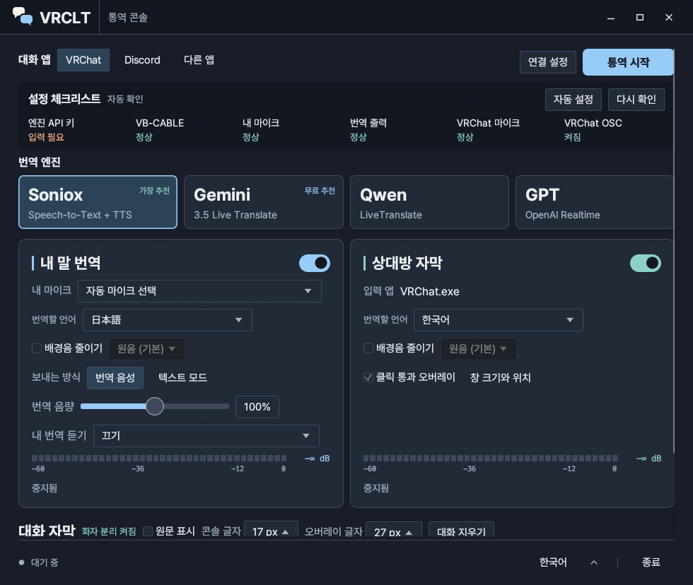
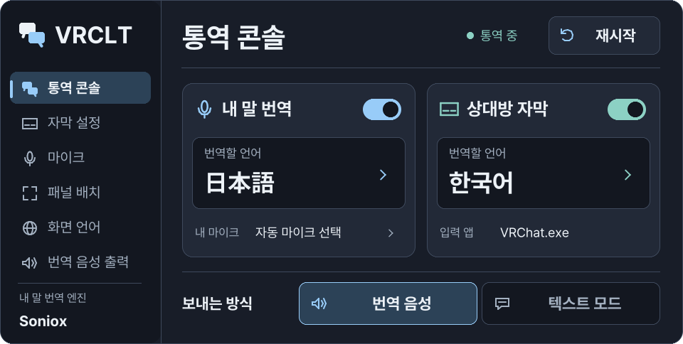

<picture>
  <source media="(prefers-color-scheme: dark)" srcset="docs/brand/logo-dark.svg">
  
</picture>

[English](README.md) | [한국어](README.ko.md) | [日本語](README.ja.md) | [简体中文](README.zh.md)

# VRCLT 2.0

내 말은 상대의 언어로 보내고, 상대방이 하는 말은 자막으로 읽을 수 있습니다. Windows용 통역 콘솔 한 화면에서 VRChat과 Discord의 양방향 통역을 조작합니다.

**[Windows용 다운로드](https://github.com/VRCLT/VRCLT/releases/latest)** | [릴리스 노트](docs/releases/v2.0.0.md) | [사용 안내](https://github.com/VRCLT/VRCLT/wiki)



## 빠른 시작

1. 기존 VRCLT를 종료하고 Windows x64 실행 파일을 여세요. ZIP을 받았다면 압축을 풀고 `vrclt/vrclt.exe`를 실행하세요. 두 파일 모두 `%LOCALAPPDATA%\vrclt\config.yaml`에서 기존 설정과 API 키를 읽습니다.
2. **연결 설정**에서 번역 엔진을 선택하고 API 키를 입력하세요. 화자를 구분하는 대화에는 **Soniox**를 가장 추천합니다. 무료로 시작하려면 **Gemini 3.5 Live Translate**를 선택하세요. **Qwen**과 **GPT (OpenAI Realtime)**도 지원합니다. 요금과 사용 한도는 서비스별로 다릅니다.
3. 내 마이크, 자막을 받을 앱, 번역할 언어를 고르세요. 상단 **설정 체크리스트**에서 연결을 확인하거나 **자동 설정**을 연 뒤 **통역 시작**을 누르세요.

Windows에서 VCRUNTIME 또는 MSVCP DLL이 없다고 나오면 [Microsoft Visual C++ x64 런타임](https://aka.ms/vs/17/release/vc_redist.x64.exe)을 설치하세요.

## 음성과 텍스트

텍스트 모드는 내 말의 번역문을 OSC로 VRChat 채팅창에 보냅니다. 텍스트 모드와 상대방 자막은 VB-CABLE 없이도 쓸 수 있습니다. 번역 음성을 보낼 때는 출력 장치를 CABLE Input으로, 상대 앱의 마이크를 CABLE Output으로 선택하세요. 내 헤드폰으로 번역 음성을 들으면서 음량도 조절할 수 있습니다.

## 자막과 SteamVR

원문 표시, 글자 크기, 대화 지우기를 지원합니다. PC 자막 창은 클릭이 통과합니다. SteamVR에서는 손목을 보면 메뉴가 나타납니다. 패널을 그립으로 잡아 옮기거나 자막판 아래 모서리를 트리거로 끌어 크기를 조절하세요. 자동 시작은 **SteamVR 설정 → 시작/종료 → 시작 오버레이 앱 선택**에서 바꿀 수 있습니다.



## 음성 설정

배경음이 섞일 때는 입력별로 DeepFilterNet3(CPU) 또는 Nemotron RE-USE(GPU)를 켤 수 있습니다. GPU 모델은 처음 선택하면 내려받습니다. Soniox에서는 준비된 대사를 녹음해 내 목소리를 만들고 저장한 음성을 선택할 수 있습니다.

## 빌드

Windows x64에서 Rust stable MSVC, Visual Studio C++ 빌드 도구, CMake, libclang을 사용합니다.

```powershell
./scripts/build_native.ps1 -Test
./scripts/package_release.ps1 -SkipBuild
```

[MIT](LICENSE) | [Third-party licenses](licenses)
