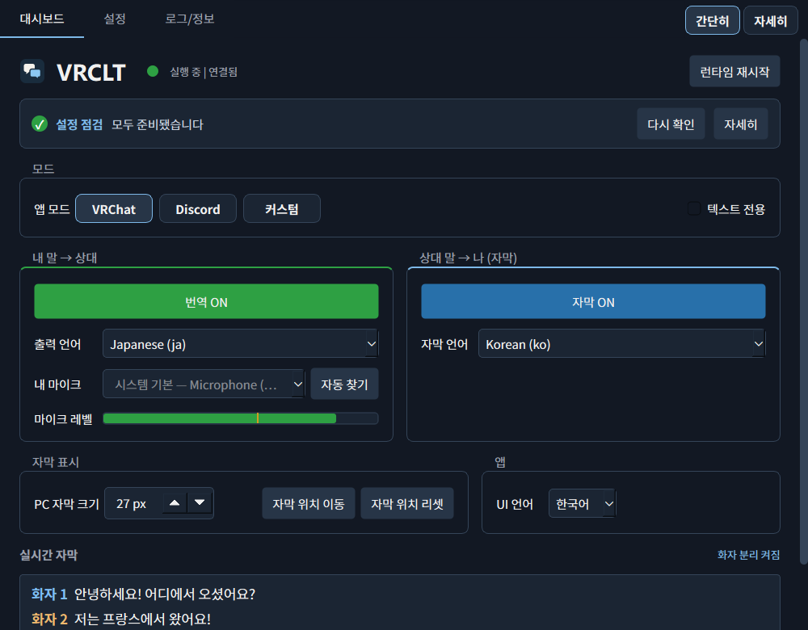
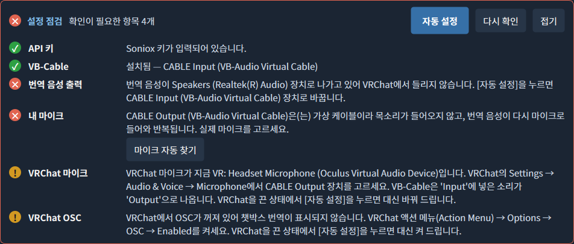
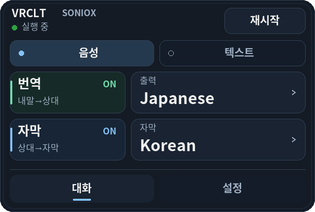
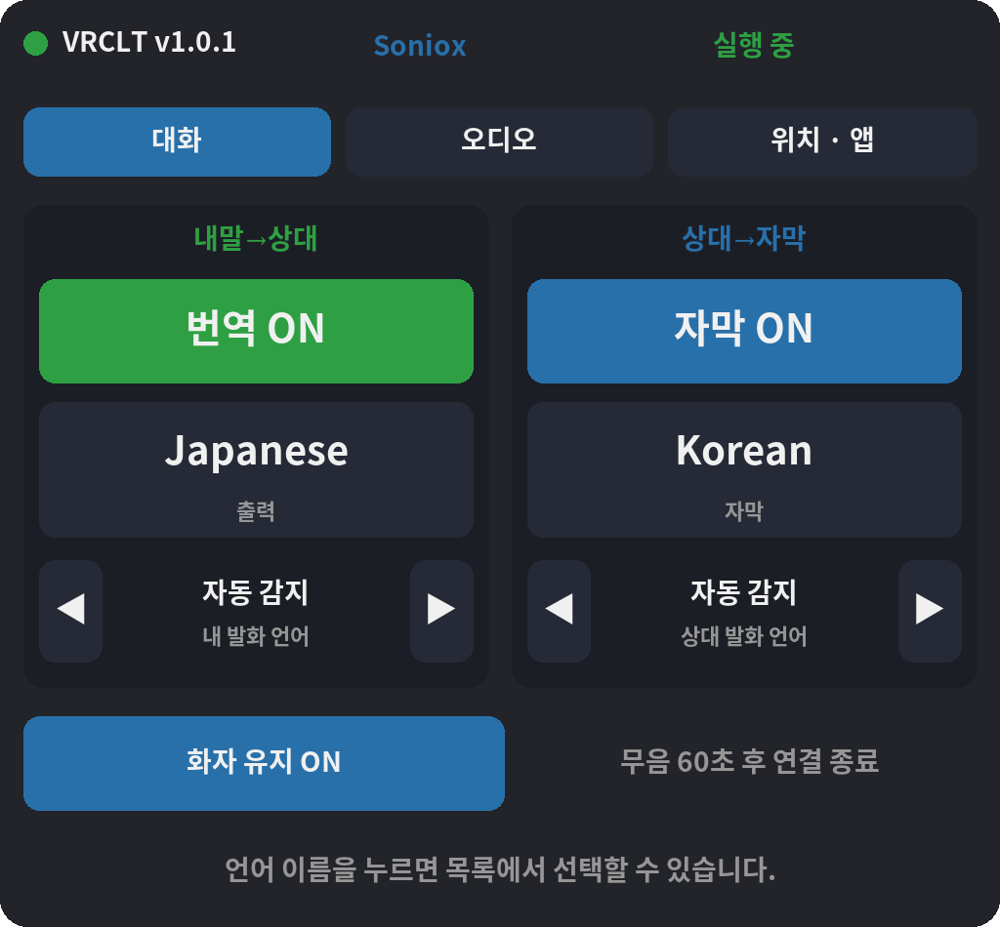

<div align="center">

<h1>
  <picture>
    <source media="(prefers-color-scheme: dark)" srcset="docs/brand/logo-dark.svg">
    
  </picture>
</h1>

<p><a href="https://vrclt.github.io/ko/">공식 홈페이지</a></p>

### 내 언어로 말하면, 상대의 언어로 들립니다.

Windows용 **VRChat** · **Discord** 실시간 음성 번역과 실시간 자막.

[](https://github.com/shgeum/VRCLT/releases/latest) [](https://github.com/shgeum/VRCLT/releases) [](#요구사항) [](LICENSE)

[English](README.md) · **한국어** · [日本語](README.ja.md) · [中文](README.zh.md)

<br>



<br><br>

[**⬇ VRCLT 내려받기**](https://github.com/shgeum/VRCLT/releases/latest) &nbsp;·&nbsp; [빠른 시작](#빠른-시작) &nbsp;·&nbsp; [자세한 문서](#설치-방법)

</div>

## VRCLT를 쓰는 이유

<table>
<tr>
<td width="50%" valign="top">

### 🎙️ 내 목소리 그대로 번역

평소처럼 말하면 VRCLT가 실시간으로 번역해 자연스러운 번역 음성을 VRChat·Discord 마이크로 보냅니다. 상대는 그냥 자기 언어로 내 말을 듣습니다.

</td>
<td width="50%" valign="top">

### 💬 실시간 자막

다른 사람의 말이 SteamVR, 데스크톱 오버레이, 앱 화면에 자막으로 뜹니다. 화자를 구분하는 엔진에서는 화자 번호도 함께 표시됩니다.

</td>
</tr>
<tr>
<td width="50%" valign="top">

### ⚡ 원클릭 설정

설정 점검이 빠진 것을 알려 줍니다. **자동 설정**은 오디오 연결, 마이크 선택, VRChat 마이크·OSC 설정까지 맞추고, **VB-Cable 자동 설치**는 공식 설치 프로그램을 대신 실행합니다.

</td>
<td width="50%" valign="top">

### 🥽 VR을 위해 만든 앱

손목 메뉴와 SteamVR 대시보드 페이지로 VR 안에서 바로 조작하고, 자막은 눈앞에 떠 있으며, SteamVR과 함께 자동으로 시작할 수 있습니다.

</td>
</tr>
<tr>
<td width="50%" valign="top">

### 💭 VRChat 챗박스

원문과 번역문을 OSC로 챗박스에 보냅니다. 텍스트 전용 모드는 내 목소리는 그대로 두고 번역 텍스트만 더합니다.

</td>
<td width="50%" valign="top">

### 🌐 엔진 4종, 70개 이상 언어

Google Gemini Live, Qwen3.8 LiveTranslate, OpenAI gpt-realtime-translate, Soniox 중에서 가격·지역·음성·화자 분리에 맞게 고를 수 있습니다.

</td>
</tr>
</table>

## 빠른 시작

1. [Releases](https://github.com/shgeum/VRCLT/releases/latest)에서 `vrclt-v<version>-windows-x64.exe`를 **내려받아 실행**합니다. 설치 과정은 없습니다.
2. **API 키를 입력합니다.** 기본 엔진은 Gemini입니다. [Google AI Studio](https://aistudio.google.com/apikey)에서 키를 만들어 **설정 → Gemini API 키**에 붙여 넣으세요. 다른 엔진은 [번역 엔진](#번역-엔진)을 참고하세요.
3. **나머지는 설정 점검에 맡깁니다.** VB-Cable이 없으면 **VB-Cable 자동 설치**를 누르고, VRChat을 끈 뒤 **자동 설정**을 누르세요.
4. **VRChat을 켜고 말하면 됩니다.** 번역·자막은 대시보드나 손목 메뉴에서 켜고 끕니다.

<p align="center"></p>

## VR에서

<p align="center">
<br><br>
&nbsp;&nbsp;

</p>

자막은 눈앞에 떠 있고, 손목 메뉴로 번역·자막·언어를 바꾸며, SteamVR 대시보드 페이지에서 언어·오디오 장치·패널 배치를 다룹니다.

<details>
<summary><b>전체 기능 목록</b></summary>

- 대시보드, 설정, 로그/정보 탭을 가진 Windows 자체 UI
- 창 열기, 설정 열기, 번역/자막 토글, 종료를 제공하는 트레이 메뉴
- 아웃바운드 번역: 내 마이크 -> selected engine -> 번역 음성 -> 대상 앱 마이크
- 인바운드 자막: 대상 앱 오디오 -> selected engine -> 번역 자막
- 네 가지 번역 엔진: Google Gemini Live(기본), Alibaba Qwen3.8 LiveTranslate, OpenAI gpt-realtime-translate, Soniox
- VRChat OSC 챗박스, 아바타 OSC 제어, SteamVR 자막, 손목 메뉴 지원
- SteamVR 대시보드 설정 패널과 SteamVR 자동 시작(시작/오버레이 앱 등록) 지원
- 원래 목소리는 그대로 보내고 OSC 챗박스 번역 텍스트만 추가하는 VRChat 텍스트 전용 모드
- Discord 프로세스 오디오 캡처와 VRChat 전용 기능 자동 비활성화
- 지금 소리를 내고 있는 프로세스 목록에서 골라 아무 앱이나 캡처하는 커스텀 모드
- 원음 송출은 48 kHz 원본 마이크 스트림을 바로 사용하고, Gemini 번역용 스트림은 별도로 리샘플링
- GitHub Releases 업데이트 알림과 API 키, 저장 언어 목록, UI 언어, 창 닫기 동작, 선택한 오디오 장치를 보존하는 안전한 설정 리셋
- [VRCLT Releases](https://github.com/shgeum/VRCLT/releases)에서 받을 수 있는 Windows exe
- 사용자 설정 저장 위치: `%LOCALAPPDATA%\vrclt\config.yaml`

</details>

## 설치 방법

### 요구사항

- Windows 11 권장
- 선택한 엔진의 API 키: Gemini, Qwen/DashScope, OpenAI 또는 Soniox
- [VB-Audio Virtual Cable](https://vb-audio.com/Cable/)
- VR 오버레이와 손목 UI를 사용할 경우 SteamVR
- VRChat 챗박스/아바타 제어를 사용할 경우 VRChat OSC 활성화

### 1. vrclt 다운로드

최신 Windows 실행 파일은 [VRCLT Releases](https://github.com/shgeum/VRCLT/releases)에서 받을 수 있습니다.

아래와 같은 이름의 파일을 다운로드합니다.

```text
vrclt-v<version>-windows-x64.exe
```

릴리스 exe는 설정을 다음 위치에 저장합니다.

```text
%LOCALAPPDATA%\vrclt\config.yaml
```

API 키는 이 파일에 평문으로 저장됩니다.

### 2. VB-Audio Virtual Cable 설치

VRChat 또는 Discord가 번역 음성을 마이크처럼 받게 하려면 VB-Audio Virtual Cable이 필요합니다.

**가장 쉬운 방법:** 대시보드의 **설정 점검** 패널에서 **VB-Cable 자동 설치**를 누르세요. vrclt가 공식 사이트(www.vb-cable.com)에서 패키지를 내려받아 VB-Audio의 디지털 서명을 확인한 뒤 VB-Audio의 설치 프로그램을 엽니다. Windows 권한 확인 창을 허용하고 **Install Driver**를 누른 다음 완료 창을 닫으면, vrclt가 장치를 다시 읽고 **자동 설정**을 이어서 합니다. VB-CABLE은 VB-Audio의 기부형(donationware) 소프트웨어입니다(all participations are welcome).

직접 설치하려면:

1. [VB-Audio Virtual Cable](https://vb-audio.com/Cable/)에서 **VB-CABLE**을 다운로드합니다.
2. 다운로드한 ZIP 파일의 압축을 풉니다.
3. `VBCABLE_Setup_x64.exe`를 우클릭하고 **관리자 권한으로 실행**합니다.
4. **Install Driver**를 누릅니다.
5. `CABLE Input` / `CABLE Output` 장치가 보이지 않으면 Windows를 재시작합니다.

설치 후 Windows에는 다음 두 장치가 생깁니다.

| 장치 | 의미 | 어디에서 선택하나 |
| --- | --- | --- |
| `CABLE Input` | 가상 케이블의 재생/출력 쪽 | vrclt의 번역 음성 출력 장치로 선택 |
| `CABLE Output` | 가상 케이블의 녹음/마이크 쪽 | VRChat 또는 Discord의 마이크로 선택 |

실제 마이크는 vrclt에서 선택합니다. 번역 음성을 상대에게 보내려면 VRChat/Discord의 마이크를 실제 마이크가 아니라 `CABLE Output`으로 설정해야 합니다.

### 3. Gemini API 키 발급 방법

1. [Google AI Studio](https://aistudio.google.com/)에 접속합니다.
   - Google 계정으로 로그인합니다. 계정이 없으면 새로 만듭니다.
2. 왼쪽 사이드바 하단 또는 상단의 **Get API key** 버튼을 클릭합니다.
   - 또는 직접 [https://aistudio.google.com/apikey](https://aistudio.google.com/apikey)로 이동합니다.
3. **Create API key** 버튼을 클릭합니다.
4. API 키를 사용할 Google Cloud 프로젝트를 선택합니다.
   - 기존 프로젝트가 없다면 **Create API key in new project**를 선택하면 자동으로 생성됩니다.
5. 생성된 API 키(`AIza...`로 시작하는 문자열)를 복사합니다.
   - 키는 한 번만 표시되므로 안전한 곳에 보관합니다.
6. 복사한 키를 `vrclt` 설정 탭의 **API 키** 항목에 붙여넣거나,
   `config.yaml`의 `api_key` 값으로 설정합니다.

> **참고**: Gemini API는 무료 티어(분당 요청 수 제한)가 있어 개인 사용에는 충분합니다.
> API 키는 타인에게 공유하지 않습니다. `config.yaml`에 평문으로 저장되므로 파일을 공개 저장소에 올리지 마세요.

### 3b. 대안: Qwen API 키 (Gemini를 사용할 수 없는 지역용)

거주 지역에서 Google 서비스를 사용할 수 없다면(예: 중국 본토), vrclt는 Gemini
대신 **Alibaba Qwen3.8 LiveTranslate**를 사용할 수 있습니다.

1. Alibaba Cloud 계정을 만들고 **Model Studio**를 활성화합니다.
   - 중국 본토: [bailian.console.aliyun.com](https://bailian.console.aliyun.com/)
   - 국제(싱가포르): [Alibaba Cloud Model Studio](https://www.alibabacloud.com/en/product/modelstudio)
2. API 키(DashScope 키, `sk-...`로 시작)를 생성합니다.
   **키는 리전에 묶여 있습니다**: 본토(베이징) 키는 `beijing` 엔드포인트에서만,
   국제 키는 `intl`에서만 동작합니다.
3. vrclt 설정에서 **번역 엔진**을 `qwen`으로 바꾸고, 키를
   **Qwen API 키 (DashScope)**에 붙여넣은 뒤, 키에 맞는 **Qwen 서버**
   (중국 본토는 `beijing`, 그 외에는 `intl`)를 선택합니다. 키는
   `DASHSCOPE_API_KEY` 환경 변수로도 지정할 수 있습니다.
4. **Qwen 워크스페이스 ID — `intl`에서는 필수**: 국제(싱가포르) 엔드포인트는
   워크스페이스 전용 도메인을 통해서만 제공됩니다. Model Studio 콘솔 홈에서
   왼쪽 아래 아이콘을 클릭하고 **Workspace Details**를 열어
   ID(`llm-7c72iiw36kd8****` 형태)를 복사한 뒤 **Qwen 워크스페이스 ID** 항목에
   붙여넣습니다. `beijing` 엔드포인트는 비워 둘 수 있습니다(기존 공용
   `dashscope` 도메인 사용).
   참고: [Obtain the workspace ID](https://www.alibabacloud.com/help/en/model-studio/obtain-api-key-app-id-and-workspace-id)
5. 기본 모델 `qwen3.8-livetranslate-flash-realtime`은 발화 언어를 자동 감지하고
   화자를 구분합니다. **Qwen 모델**을 `qwen3.5-livetranslate-flash-realtime`으로
   바꾼 경우에만 **내 발화 언어**와 **상대 발화 언어**를 설정합니다 — Qwen 3.5는
   발화 언어를 자동 감지하지 못합니다(아래 "번역 엔진" 섹션 참고).

### 3c. Soniox 설정

1. [Soniox 콘솔](https://console.soniox.com)을 열어 계정을 만들고 로그인합니다.
2. **My First Project** 또는 사용할 프로젝트를 열고 **API Keys**에서 키를 만듭니다.
   [공식 시작 안내](https://soniox.com/docs/stt/get-started)의 프로젝트별 키 발급 절차를 따릅니다.
   v1.0.0은 미국(US) 서버를 사용하므로 리전을 선택할 수 있다면 **US 프로젝트**를 사용하세요.
   다른 리전 서버로 전환하는 설정은 아직 없습니다. [리전 안내](https://soniox.com/docs/data-residency)
3. [Billing overview](https://console.soniox.com/org/billing/overview/)에서 API 사용 잔액을
   확인하고 필요한 경우 충전합니다. 요금은 [API 요금표](https://soniox.com/pricing)를
   확인하세요. 무료 크레딧 유무와 금액은 가입 시 콘솔에 표시되는 조건을 기준으로 합니다.
4. vrclt의 **설정 → 번역 엔진**에서 `soniox`를 선택하고 **Soniox API 키**에 붙여넣습니다.
   처음에는 인식 모델 `stt-rt-v5`, TTS 모델 `tts-rt-v2`, 음성 `Daniel`을 그대로 사용합니다.
5. 앱 모드와 실제 마이크, 번역 음성 출력 장치를 선택한 뒤 **설정 저장 및 재시작**을 누릅니다.
   가상 마이크 연결은 아래 **첫 실행 설정**의 `CABLE Input` / `CABLE Output` 안내를 따릅니다.
6. 대시보드의 **출력 언어**는 내 말을 번역할 언어, **자막 언어**는 상대 말을 읽을 언어입니다.
   예를 들어 한국어로 말하며 일본어 대화를 하려면 출력은 일본어, 자막은 한국어로 둡니다.
   **내/상대 발화 언어**는 자동 감지로 두거나 한국어/일본어를 인식 힌트로 선택합니다.

환경 변수 `SONIOX_API_KEY`를 사용하려면 앱의 Soniox API 키 칸을 비워 두고,
환경 변수 설정 후 앱을 완전히 종료했다가 다시 실행합니다. `config.yaml`을 직접 수정할 때는
아래 값을 사용합니다. GUI에서 설정했다면 파일을 따로 편집할 필요는 없습니다.

```yaml
provider: soniox
soniox:
  api_key: ""  # 비어 있으면 SONIOX_API_KEY 사용
  model: stt-rt-v5
  tts_model: tts-rt-v2
  voice: Daniel
  keep_speaker_context: true
  speaker_context_idle_sec: 60.0
```

Soniox는 양방향 음성 인식·번역을 처리하며, 번역 음성을 켜면 별도의 TTS도 사용합니다.
`voice`에는 기본 제공 음성 이름이나 기존 커스텀/복제 음성 ID를 넣습니다.
마이크 목소리를 자동 복제하지 않으며, 텍스트 전용 파이프라인은 TTS에 연결하지 않습니다.
**내/상대 발화 언어**는 자동 감지로 두거나 인식 힌트로 지정할 수 있습니다.
화자 분리로 상대방의 원문과 번역을 화자별로 유지하고 자막에 화자 번호를 표시합니다.
이 번호는 인식 세션 안에서만 유효하며 VRChat 계정이나 실제 이름을 식별하지 않습니다.
번역 음성은 모든 화자에게 설정한 하나의 TTS 음성을 사용합니다.

**무음 중 화자 구분 유지**는 기본으로 켜져 있습니다(`soniox.keep_speaker_context: true`).
짧은 대화 공백에는 인식 세션을 유지하고 **60초 동안 무음이면 연결을 닫습니다**
(`soniox.speaker_context_idle_sec: 60.0`). 설정에서 5~600초로 조절할 수 있습니다.
시간을 늘리면 재연결은 줄어들지만 과금되는 연결도 더 오래 유지됩니다.
Soniox 대시보드에는 체크 상태와 현재 적용되는 무음 종료 시간이 표시되며,
체크박스는 설정 화면과 같은 값을 사용합니다. 기존에 저장한 선택은 유지됩니다.
화자 분리 자체는 어느 쪽이든 켜져 있습니다. Soniox는 텍스트 전용 모드에서도
침묵·keepalive를 포함한 전체 연결 시간에 과금합니다.
[공식 keepalive 과금 안내](https://soniox.com/docs/stt/rt/connection-keepalive)를 참고하세요.
이 설정을 끄면 `audio.mic_idle_disconnect_sec`(기본 15초)를 무음 종료 시간으로 사용합니다.
파이프라인 중지·비활성화 또는 캡처 대상 프로세스 종료 시에도 연결을 닫으며,
재연결하면 화자 구분은 새 세션에서 시작합니다. 연결을 유지해도 한 사람에게 항상 같은
번호가 붙는다고 보장하지는 않으며, Soniox가 서로 다른 화자 ID를 반환하면 구분해서 표시합니다.

로컬 모의 서버 테스트로 검증했으며, 실제 유료 Soniox API 호출은 아직 검증하지 않았습니다.

**첫 동작 확인:** 대상 앱에서 상대방이 말하는 동안 **자막**을 켜고 대시보드의 실시간 자막에
번역 자막과 화자 번호/색상이 나오는지 확인합니다. 여러 사람이 차례로 말하면 화자별 표시를
확인하기 쉽습니다. 내 음성 번역은 **번역**을 켜고 짧게 말해 확인하세요.

- 키 인증 오류(`401`): 선택한 엔진이 Soniox인지, US 프로젝트의 유효한 API 키인지 확인합니다.
- 잔액·한도 오류(`402`): 콘솔의 잔액과 프로젝트/조직 월 예산을 확인합니다.
  [공식 오류 안내](https://soniox.com/docs/api-reference/errors)
- 자막이나 음성이 없음: 대상 앱/캡처 프로세스, 번역·자막 켜짐 상태, 마이크와 출력 장치를
  확인하고 **로그/정보**의 오류를 확인합니다. 자막은 나오지만 번역 음성이 없다면
  **텍스트 전용** 설정과 음성 출력 장치도 확인합니다.

### 4. 첫 실행 설정

1. `vrclt-v<version>-windows-x64.exe`를 실행합니다.
2. 설정 탭을 열고 사용할 번역 엔진을 설정합니다.

   **Gemini 사용 시 (기본)**
   1. **Gemini API 키**에 키를 붙여넣습니다(3 단계). 엔진 설정은 이것으로
      끝입니다 — Gemini는 발화 언어를 자동으로 감지합니다.

   **Qwen 사용 시**
   1. **번역 엔진**을 `qwen`으로 바꿉니다.
   2. **Qwen API 키 (DashScope)**에 DashScope 키를 붙여넣고(3b 단계), 키의
      리전에 맞는 **Qwen 서버**(중국 본토는 `beijing`, 그 외에는 `intl`)를
      선택합니다.
   3. `intl`인 경우: **Qwen 워크스페이스 ID**를 입력합니다(3b 단계).
   4. 기본 모델 `qwen3.8-livetranslate-flash-realtime`은 여기까지면 됩니다 —
      발화 언어를 자동 감지합니다. `qwen3.5-livetranslate-flash-realtime`을
      쓴다면 **내 발화 언어**(내가 말하는 언어)와 **상대 발화 언어**(게임에서
      들려올 언어)도 설정합니다. Qwen 3.5는 자동 감지가 없어 비워 두면 영어로
      간주합니다. Qwen 3.5에서는 두 값을 나중에 대시보드 탭이나 SteamVR
      대시보드 패널에서도 바꿀 수 있습니다.

3. 앱 모드를 `vrchat`, `discord`, `custom` 중에서 선택합니다(`custom`은 설정에서 캡처할 앱을 고릅니다).
4. **마이크 입력**에는 실제 마이크를 선택합니다.
5. **음성 출력** 또는 번역 음성 출력 장치에는 `CABLE Input`을 선택합니다.
6. VRChat 또는 Discord의 마이크 입력을 **CABLE Output (VB-Audio Virtual Cable)**으로 설정합니다.
7. 설정을 저장합니다. 런타임은 자동으로 재시작됩니다.

**자동 설정(권장):** 대시보드는 **간단히** 화면과 **설정 점검** 패널로 열립니다. 패널은 API 키, VB-Cable, 번역 음성 출력, 내 마이크, VRChat 마이크·OSC 상태를 보여 줍니다. VRChat을 끈 뒤 **자동 설정**을 누르면 번역 음성을 `CABLE Input`으로 보내고, 실제 마이크(VRChat에서 쓰던 마이크, 없으면 시스템 기본)를 고르고, VRChat 마이크를 VR·데스크톱 모두 `CABLE Output`으로 바꾸고 VRChat OSC를 켭니다. **마이크 자동 찾기**는 말하는 동안 가장 크게 반응하는 마이크를 고릅니다. 위 3~6단계가 자동 설정이 하는 일이며, 자동으로 바꿀 수 없는 항목은 패널에 방법이 표시됩니다. 오른쪽 위 **자세히**를 누르면 대시보드의 모든 설정이 보입니다.

## 문제 해결

- VB-Cable 설치 후 PC 소리가 안 나옴: Windows가 `CABLE Input`을 기본 출력 장치로 바꾼 경우입니다. 스피커·헤드폰을 다시 기본 장치로 설정하세요(**설정 점검 → 소리 설정 열기**).
- 자동 설정이 VRChat 마이크나 OSC를 바꾸지 않음: VRChat을 먼저 종료하세요. VRChat은 종료할 때 설정을 덮어쓰기 때문에 vrclt는 VRChat이 꺼져 있을 때만 씁니다.
- 대상 앱에 번역 음성이 안 들어감: `outbound.tts_device`가 `CABLE Input`인지, 대상 앱 마이크가 `CABLE Output`인지 확인합니다.
- 인바운드 자막이 안 뜸: 대상 프로세스 이름이 실제 실행 중인 앱과 맞는지 확인합니다. 예: `VRChat.exe`, `Discord.exe`.
- API 키 필요 상태: 설정에 키를 입력하거나 `GEMINI_API_KEY`를 설정합니다(Qwen 엔진: `DASHSCOPE_API_KEY`).
- Qwen 키가 거부되거나 연결이 바로 실패함: `qwen.endpoint`가 키의 리전과 맞는지 확인합니다 — `beijing` 키와 `intl` 키는 서로 호환되지 않습니다 — 그리고 `intl` 사용 시 워크스페이스 ID가 설정되어 있는지 확인합니다.
- Qwen 오류 `Voice '...' is not supported`: 리터럴 음성 `default`는 음성 복제가 켜져 있을 때만 동작합니다. `qwen.voice_clone`을 켜 두거나, 모델 기본 음성을 쓰려면 **Qwen 음성 ID**를 비워 둡니다.
- Qwen 3.5가 엉뚱한 언어에서 번역함: **내 발화 언어** / **상대 발화 언어**를 설정합니다(설정, 대시보드, 또는 SteamVR 패널). Qwen 3.5는 자동 감지가 없으며, 비어 있으면 영어로 간주합니다. 기본 모델인 Qwen 3.8은 자동 감지합니다.
- VR 오버레이가 안 뜸: SteamVR이 실행 중이고 `overlay.enabled` / `wrist_ui.enabled`가 켜져 있는지 확인합니다.
- passthrough나 자막 지연이 큼: 먼저 이 README의 기본값을 사용하고, 연결이 안정적이면 `audio.turn_end_silence_sec`, `audio.inbound_turn_end_silence_sec`, `audio.subtitle_finalize_silence_sec`를 조심해서 낮춥니다.
- 설정을 초기화하고 싶음: 설정 탭의 **기본값 리셋**을 사용합니다. API 키, 출력 언어 목록, 자막 언어 목록, UI 언어, 창 닫기 동작, 선택한 오디오 장치는 유지하고 나머지를 기본값으로 되돌립니다. 앱 업데이트 후에도 vrclt가 이 리셋을 한 번 물어봅니다.

## 번역 엔진

vrclt는 네 가지 실시간 번역 엔진을 지원하며, **번역 엔진** 설정(`config.yaml`의
`provider`)으로 선택합니다. 선택한 엔진은 내 음성과 인바운드 자막 양쪽 방향에
모두 적용됩니다.

| | Gemini Live (기본) | Qwen3.8 LiveTranslate | gpt-realtime-translate | Soniox |
| --- | --- | --- | --- | --- |
| 제공자 / 키 | Google AI Studio (`GEMINI_API_KEY`) | Alibaba Cloud Model Studio / DashScope (`DASHSCOPE_API_KEY`) | OpenAI (`OPENAI_API_KEY`) | Soniox (`SONIOX_API_KEY`) |
| 필요한 설정 | API 키만 입력 | 엔진을 `qwen`으로, API 키 + 서버(`intl`은 워크스페이스 ID까지); Qwen 3.5는 **내/상대 발화 언어**도 필요 | 엔진을 `openai`로, API 키만 입력 | 엔진 `soniox` + API 키 |
| 중국 본토에서 사용 | 불가 | 가능 (`beijing` 엔드포인트) | 불가 | 미검증 |
| 발화 언어 감지 | 자동 감지 | 자동 감지 (Qwen 3.5: **수동** — "내/상대 발화 언어"를 설정해야 함) | 자동 감지 (발화 언어 설정은 무시됨) | 자동 감지; 발화 언어는 선택적 힌트 |
| 지원 언어 | `zh-Hans`/`zh-Hant`를 포함한 70개 이상 BCP-47 도착어 | 음성 지원 29개 + 텍스트 전용 31개; 중국어는 `zh` 하나뿐(간체/번체 구분 없음); 광둥어(`yue`)는 텍스트 전용 | 입력은 70개 이상이지만 도착어는 **13개뿐**(`en es pt fr ja ru zh de ko hi id vi it`); 중국어는 `zh` 하나; 세션당 도착어 1개 | 앱 지원 60개; 중국어는 `zh`, 광둥어(`yue`) 미지원 |
| 번역 음성 | 화자 목소리 재현 | 서버 측 음성 복제로 화자 목소리 재현 (`qwen.voice_clone`, 기본 `once`); 복제를 끄면 고정 음성 | 화자 목소리를 자동으로 따라감; 음성 선택 옵션 없음 | 별도 TTS; 기본 `Daniel` 또는 커스텀 음성; 자동 복제 없음 |
| 끼어들기(barge-in) | 지원 | 미지원 — 발화가 겹치면 오디오가 줄지어 재생될 수 있음 | 미지원 — 발화가 겹치면 오디오가 줄지어 재생될 수 있음 | 미지원 — 발화가 겹치면 오디오가 줄지어 재생될 수 있음 |

Qwen 참고 사항:

- `qwen.model` 기본값은 `qwen3.8-livetranslate-flash-realtime`입니다. 발화 언어를
  자동 감지하고, Soniox처럼 자막에 화자를 구분해 표시합니다. 이미 저장된 설정은
  기존 모델을 그대로 유지하므로, 바꾸려면 **Qwen 모델**을 변경하세요.
- `qwen3.5-livetranslate-flash-realtime`도 계속 사용할 수 있지만 **발화 언어
  설정이 필수입니다.** 설정 탭, 대시보드 탭, 또는 SteamVR 대시보드 패널의
  **대화** 페이지에서 설정합니다. 비어 있으면 영어로 간주합니다. Qwen 3.5는
  화자 구분을 표시하지 않습니다.
- `zh-Hans`/`zh-Hant` 도착어는 둘 다 `zh`로 Qwen에 전달됩니다.
- 선택한 도착어에 Qwen 음성 지원이 없으면 vrclt가 자동으로 세션을 텍스트 전용으로
  실행합니다(챗박스/자막은 계속 동작합니다).
- 엔드포인트: `intl`(싱가포르) 또는 `beijing`. `intl`은 Model Studio
  워크스페이스 ID가 **필수**이며, `beijing`은 없어도 동작합니다(위 3b 단계 참고).
- 음성 복제: `qwen.voice_clone: once`(기본)는 세션 시작 시 화자 목소리를
  복제합니다 — 내 마이크에 알맞고 오디오 지연도 낮게 유지됩니다. `always`는
  응답마다 다시 복제하고(여러 명이 말하는 오디오용이지만 합성 시작이 눈에 띄게
  늦어짐), `off`는 모델 기본 음성 또는 `qwen.voice`에 설정한 미리 복제된
  음성 ID(`qwen-translate-vc-...`)를 사용합니다.

## 앱 모드

| 모드 | 대상 | 동작 |
| --- | --- | --- |
| `vrchat` | VRChat | `VRChat.exe` 오디오 캡처, OSC 챗박스, 아바타 OSC 제어, SteamVR 자막, 손목 UI 활성화 |
| `discord` | Discord | 루트 `Discord.exe` 프로세스 트리 오디오 캡처, VRChat OSC/SteamVR 기능 비활성화, PC UI와 데스크톱 자막 유지 |
| `custom` | 그 외 아무 앱 | 설정에서 고른 프로세스를 캡처, SteamVR 자막·손목 메뉴는 유지, VRChat OSC 기능은 비활성화 |

설정에서 모드를 고르거나 실행 한 번에만 인자로 지정할 수 있습니다.

```powershell
.\vrclt.exe run --app vrchat
.\vrclt.exe run --app discord
.\vrclt.exe run --app custom
```

VRChat에서 텍스트 전용으로 쓰려면 대시보드 또는 설정의 **텍스트 전용**을
켭니다. 원래 마이크 음성은 VRChat으로 그대로 passthrough되고, 선택한 엔진의 번역 결과는
번역 음성 없이 OSC 챗박스 텍스트로만 전송됩니다.

Discord Canary 또는 PTB를 사용한다면 설정 또는 `app.profiles.discord.process`에서
프로세스 이름을 바꿉니다.

브라우저, 미디어 플레이어, 다른 게임 등 그 외 앱의 자막을 보려면 **커스텀**
모드로 바꾸고 설정에서 **커스텀 캡처 프로세스**를 지정합니다. 이 목록을 열면
Windows 오디오 세션을 가진 프로세스가 나열되며, 지금 소리를 내고 있는 것이
표시와 함께 맨 위에 옵니다. exe 이름을 미리 알 필요가 없습니다. **캡처
프로세스** 항목도 같은 선택기를 쓰며, 지금 실제로 캡처 중인 대상을 보여줍니다.

## 자체 UI

대시보드는 번역·자막·언어·오디오 조작을 모으고, 현재 엔진과 설정 바로가기를 보여줍니다.
언어 목록 편집과 화면·앱 부가 옵션은 펼쳐서 사용할 수 있습니다. 설정은 카테고리로
탐색하며 선택한 엔진의 항목만 표시하고, 검색으로 필요한 항목을 찾습니다.
로그는 한 번에 갱신하고 따라잡기 읽기를 256 KiB, 기록을 2,000줄, 미완성 줄을
64 KiB로 제한합니다. 재연결 대기는 주기적 확인 없이 중지 이벤트에 바로 반응합니다.

대시보드:

- 오른쪽 위 **간단히 / 자세히** 전환. 새로 설치하면 간단히 화면(설정 점검, 앱 선택, 번역·자막 ON/OFF, 언어, 내 마이크와 자동 찾기, 마이크 레벨, 실시간 자막)으로 시작하며, 설정 점검은 모두 준비되면 한 줄로 접힙니다. 자세히 화면에는 텍스트 전용, 장치, 엔진 버튼, 언어 목록 편집, 발화 언어, 볼륨, 표시·앱 옵션이 더해집니다. 마이크 목록에는 번역 음성이 되돌아오기만 하는 `CABLE Output`이 나오지 않습니다. v1.0.0 이전에 저장한 설정은 자세히 화면을 유지합니다.
- **자동 설정**, **마이크 자동 찾기**, **VB-Cable 자동 설치**가 있는 **설정 점검** 패널. 모두 준비되면 한 줄로 접힙니다
- 런타임 상태와 연결 상태
- VRChat/Discord/커스텀 모드 토글과 VRChat 텍스트 전용 토글
- 번역 ON/OFF
- 자막 ON/OFF
- PC 전역 핫키로 번역/자막 토글
- 출력 언어와 자막 언어, Gemini Live Translation 70개 이상 지원 언어 검색/추가
- 마이크 입력과 번역 음성 출력 장치 선택, 출력 테스트 사운드 버튼 포함; 장치 새로고침은 런타임을 재시작하며 나중에 꽂은 장치도 인식합니다
- 번역 음성 볼륨 슬라이더와 감지 임계값 표시가 있는 실시간 마이크 레벨 미터
- 내/상대 발화 언어: Qwen 3.5는 필수, Soniox는 선택적 인식 힌트, Gemini/OpenAI/Qwen 3.8은 자동 감지
- PC 자막 위치 이동/리셋, 상자 크기, 글자 크기 조절
- 실시간 자막 미리보기

설정:

- 번역 엔진(Gemini / Qwen / OpenAI / Soniox), API 키, 모델, Qwen 엔드포인트/워크스페이스
- 앱 모드와 대상 프로세스
- 마이크, 번역 음성 출력, 모니터 출력, 인바운드 오디오 장치
- 기본 도착어와 저장된 언어 목록
- PC 전역 핫키 설정
- 오디오 임계값과 VAD 설정
- API 키, 출력 언어 목록, 자막 언어 목록, UI 언어, 창 닫기 동작, 선택한 오디오 장치는 유지하는 기본값 리셋 버튼
- OSC, 챗박스, SteamVR 오버레이, 손목 UI 옵션
- UI 언어와 UI 모드

로그/정보:

- 현재 설정 경로
- 현재 로그 파일 경로
- 최근 로그 내용

창을 닫으면 앱은 트레이로 숨겨집니다. 런타임을 멈추고 완전히 종료하려면 트레이의
`Quit` 또는 `종료` 동작을 사용합니다.

## 오디오 라우팅

아웃바운드 번역:

```text
microphone -> selected engine -> translated voice -> CABLE Input
                                     target app mic <- CABLE Output
```

인바운드 자막:

```text
target app process audio -> ProcTap -> selected engine -> subtitles
```

번역이 OFF이면 마이크는 Gemini를 거치지 않고 `CABLE Input`으로 바로 전달됩니다.
VRChat **텍스트 전용**에서는 원래 목소리가 항상 passthrough되고, 번역 토글은
Gemini 텍스트 번역과 챗박스 출력만 제어합니다.

원음 passthrough는 캡처한 48 kHz 마이크 스트림을 그대로 사용하고, Gemini 번역용
스트림은 별도로 리샘플링합니다. 그래서 passthrough가 번역 세션을 기다리지 않고,
불필요한 음질 손실도 줄입니다.

## VRChat 기능

VRChat 모드에서는 다음 기능을 사용할 수 있습니다.

- 번역 텍스트 OSC 챗박스 출력
- `VRCLT_Enabled`, `VRCLT_Lang` 같은 아바타 OSC 파라미터
- 인바운드 자막용 SteamVR 자막 오버레이
- 높이를 줄인 간결한 SteamVR 손목 메뉴. 첫 **대화** 화면에 번역·자막·출력/자막 언어·연결 상태와 별도의 **음성 / 텍스트** 선택 버튼, 런타임 재시작을 모았습니다. **설정**에는 UI 언어·자막 크기·패널 이동/위치 초기화·Soniox 화자 구분 유지를 배치했습니다. 기존 시선·그립 조작도 유지합니다
- 손목 메뉴 기본 너비는 **14cm**이며 패널 높이도 줄였습니다. 기존에 저장한 너비는 유지하고, 앱 설정의 손목 너비에서 원하는 크기로 조절할 수 있습니다. 16cm 미만의 너비도 정상 적용됩니다
- **대화 / 오디오 / 위치 · 앱**으로 나눈 SteamVR 대시보드(SteamVR 메뉴에서 vrclt 아이콘 선택). **대화**에는 번역·자막·언어·연결/오류 상태, **오디오**에는 마이크·음성 출력 선택과 번역 음성 볼륨, **위치 · 앱**에는 패널 위치와 앱 제어를 모았습니다. 디바이스 변경은 마지막 클릭 후 잠시 뒤 런타임 재시작과 함께 적용됩니다
- SteamVR 대시보드에서 Qwen 3.5의 발화 언어와 Soniox의 선택적 인식 힌트를 설정할 수 있으며, 손목 메뉴에서는 번역 출력 언어와 자막 언어를 선택합니다. Soniox를 선택하면 두 VR 패널 모두 **무음 중 화자 구분 유지**와 적용 중인 무음 종료 시간을 표시하며, PC UI와 같은 저장값을 사용합니다. 이 스위치를 꺼도 화자 분리 자체는 켜져 있습니다
- SteamVR 자동 시작: 릴리스 exe가 SteamVR 설정 > 시작/오버레이 앱에 자동 등록되며, 자동 시작은 SteamVR 설정 또는 vrclt 설정에서 켜고 끕니다
- 새 버전으로 업데이트한 뒤에는 새 exe를 한 번 실행해 주세요. 등록 자체는 유지되지만, 자동 시작이 가리키는 exe 경로는 첫 실행 때 새 파일로 갱신됩니다
- VR 자막 편집 laser/cursor 표시와 모서리 크기 조절 핸들

`ui.mode: auto`에서는 SteamVR이 실행 중일 때 VR 기능이 활성화됩니다. 강제로 VR
오버레이를 켜려면 `ui.mode: vr`, 끄려면 `ui.mode: desktop`을 사용합니다.

## 파일과 경로

| 항목 | 경로 |
| --- | --- |
| 설정 | `%LOCALAPPDATA%\vrclt\config.yaml` |
| 로그 | `%LOCALAPPDATA%\vrclt\logs\vrclt.log` |

다른 설정 파일을 쓰려면 `VRCLT_CONFIG` 환경 변수로 경로를 지정합니다.
`config.yaml`의 모든 키는 위키의 [설정 레퍼런스](https://github.com/shgeum/VRCLT/wiki/%EC%84%A4%EC%A0%95-%EB%A0%88%ED%8D%BC%EB%9F%B0%EC%8A%A4)에 정리되어 있습니다.

## 개발

소스에서 실행, 테스트, exe 빌드, 릴리스 절차는 [위키](https://github.com/shgeum/VRCLT/wiki/%EA%B0%9C%EB%B0%9C-%EA%B0%80%EC%9D%B4%EB%93%9C)에 있습니다.
변경 사항은 풀 리퀘스트로 `main`에 들어가며, 새 버전이 머지되면 릴리스가 자동으로 게시됩니다.

## 감사

- [Noto Sans CJK](https://github.com/notofonts/noto-cjk)와 [Pretendard](https://github.com/orioncactus/pretendard): 다국어 UI 폰트 커버리지.
- [PySide6](https://doc.qt.io/qtforpython-6/): Windows 자체 UI.
- [OpenVR](https://github.com/ValveSoftware/openvr), GLFW, PyOpenGL: SteamVR 오버레이 렌더링.
- [VB-Audio Virtual Cable](https://vb-audio.com/Cable/): 앱 간 오디오 라우팅.
