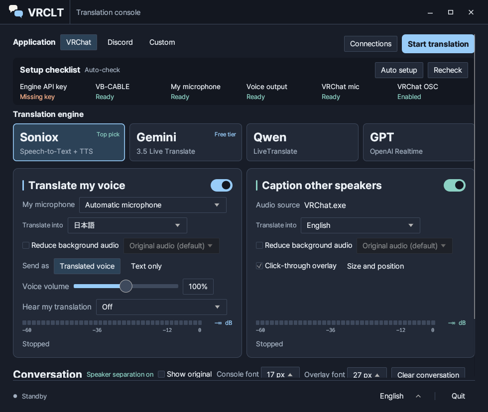
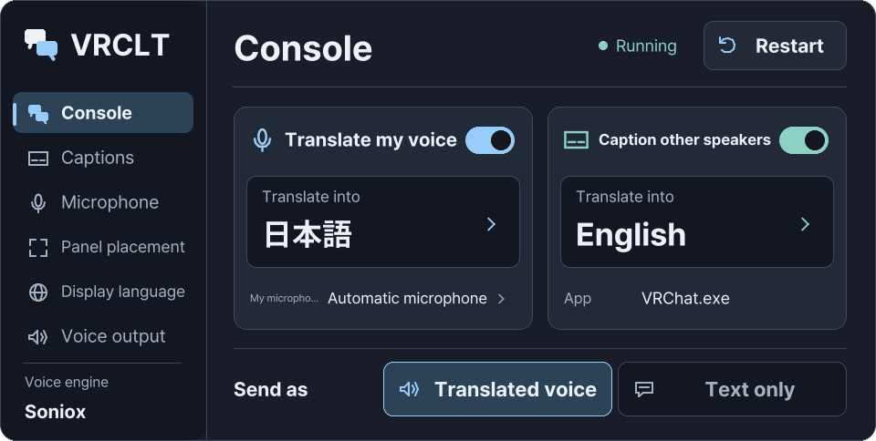

<picture>
  <source media="(prefers-color-scheme: dark)" srcset="docs/brand/logo-dark.svg">
  
</picture>

[English](README.md) | [한국어](README.ko.md) | [日本語](README.ja.md) | [简体中文](README.zh.md)

# VRCLT 2.1

Live translation for VRChat and Discord on Windows. Speak into your microphone, read what other people say, and control both directions from a single native console.

**[Download for Windows](https://github.com/VRCLT/VRCLT/releases/latest)** | [Release notes](docs/releases/v2.1.0.md) | [Guides](https://github.com/VRCLT/VRCLT/wiki)



## Quick start

1. Close the previous version and run the Windows x64 EXE. The ZIP contains the same executable at `vrclt/vrclt.exe`. Both read your existing settings and keys from `%LOCALAPPDATA%\vrclt\config.yaml`.
2. Open **Connections**, choose a translation engine and enter your provider API key. We recommend **Soniox** for speaker-labeled conversations and **Gemini 3.5 Live Translate** for its free tier. **Qwen** and **GPT (OpenAI Realtime)** are also available. Each provider sets its rates and limits.
3. Select your microphone, the app to caption and the target languages. The **Setup checklist** shows the detected devices and opens **Auto setup**. Select **Start** to translate.

From 2.1, VRCLT downloads stable updates and installs them when you quit. Open **Updates** at the bottom of the console to check manually, restart immediately or turn automatic updates off.

If Windows reports a missing VCRUNTIME or MSVCP DLL, install the [Microsoft Visual C++ x64 runtime](https://aka.ms/vs/17/release/vc_redist.x64.exe).

## Voice and text

Text mode sends microphone translations to the VRChat chatbox through OSC. With VB-CABLE connected, your original microphone continues through the cable in text mode and while **Translate my voice** is off. Incoming captions and text mode work without VB-CABLE. For translated voice, select CABLE Input as the output and CABLE Output in the receiving app. The console can also play your translated voice through your headphones and adjust its volume.

## Captions and SteamVR

Show the original above a translation, change the font size or clear the conversation. The desktop caption window supports click-through. In SteamVR, look at your wrist to open the controls, grab a panel to move it, or drag a lower corner of the caption panel to resize it. Manage automatic startup under **SteamVR Settings → Startup / Shutdown → Choose Startup Overlay Apps**.



## Audio options

For additional noise reduction, choose DeepFilterNet3 (CPU) or optional Nemotron RE-USE (GPU) per input. The GPU model downloads on first use. Soniox also supports recording a voice sample and choosing a saved voice.

## Build

Windows x64 builds use Rust stable MSVC, Visual Studio C++ tools, CMake and libclang.

```powershell
./scripts/build_native.ps1 -Test
./scripts/package_release.ps1 -SkipBuild
```

[MIT](LICENSE) | [Third-party licenses](licenses)
