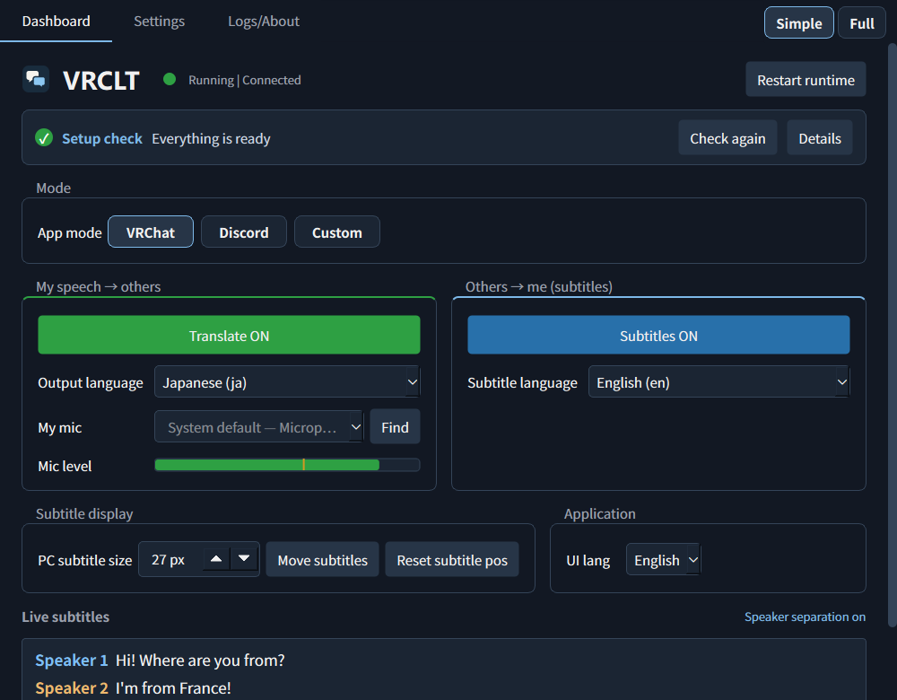
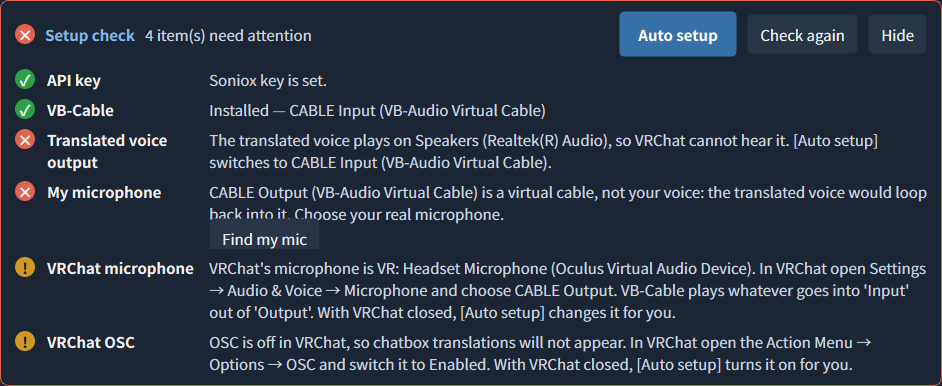
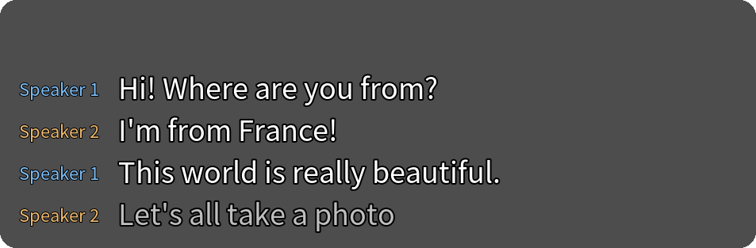
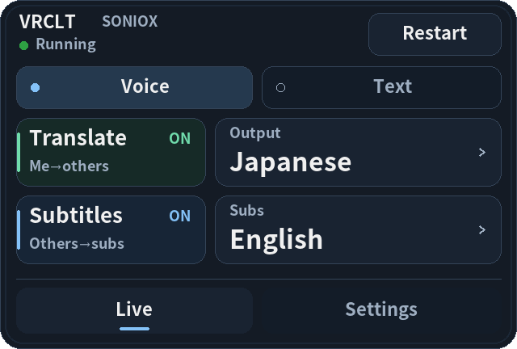
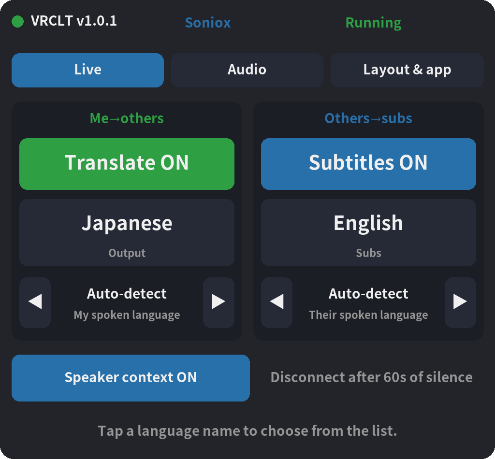

<h1>
  <picture>
    <source media="(prefers-color-scheme: dark)" srcset="docs/brand/logo-dark.svg">
    
  </picture>
</h1>

<a href="https://vrclt.github.io/">Official site</a>

### Speak your language. Be heard in theirs.

Real-time voice translation and live subtitles for **VRChat** and **Discord** on Windows.

   

**English** · [한국어](README.ko.md) · [日本語](README.ja.md) · [中文](README.zh.md)

 

  

[**⬇ Download VRCLT**](https://github.com/VRCLT/VRCLT/releases/latest) &nbsp;·&nbsp; [Quick start](#quick-start) &nbsp;·&nbsp; [Documentation](#documentation)

## Why VRCLT

<table>
<tr>
<td width="50%" valign="top">

### 🎙️ Your voice, translated

Speak normally. VRCLT translates in real time and plays a natural translated voice into VRChat or Discord as your microphone, so others simply hear you in their language.

</td>
<td width="50%" valign="top">

### 💬 Live subtitles

Everyone else's speech appears as subtitles in SteamVR, in a desktop overlay, and in the app, with speaker labels when the engine separates speakers.

</td>
</tr>
<tr>
<td width="50%" valign="top">

### ⚡ One-click setup

The Setup check shows what is missing. **Auto setup** routes the audio, picks your microphone, and sets VRChat's microphone and OSC; **Install VB-Cable** runs the official installer for you.

</td>
<td width="50%" valign="top">

### 🥽 Built for VR

A wrist menu and a SteamVR Dashboard page keep the controls in reach, subtitles float in front of you, and VRCLT can start together with SteamVR.

</td>
</tr>
<tr>
<td width="50%" valign="top">

### 💭 VRChat chatbox

Your original line and its translation go to the chatbox over OSC. Text-only mode keeps your own voice and just adds the translated text.

</td>
<td width="50%" valign="top">

### 🌐 Four engines, 70+ languages

Google Gemini Live, Qwen3.8 LiveTranslate, OpenAI gpt-realtime-translate, and Soniox: choose by price, region, voice, and speaker separation.

</td>
</tr>
</table>

## Quick start

1. **Download** `vrclt-v<version>-windows-x64.exe` from [Releases](https://github.com/VRCLT/VRCLT/releases/latest) and run it. There is nothing to install.
2. **Add an API key.** Gemini is the default. [Get a key for any engine](https://github.com/VRCLT/VRCLT/wiki/API-Keys) (step-by-step with screenshots), then paste it into **Settings → Translation**.
3. **Let the Setup check do the rest.** Click **Install VB-Cable** if it is missing, close VRChat, then click **Auto setup**.
4. **Start VRChat and talk.** Toggle **Translate** and **Subtitles** on the Dashboard or from the wrist menu.

## In VR

  
&nbsp;&nbsp;

Subtitles float in front of you, the wrist menu switches translation, subtitles, and languages, and the SteamVR Dashboard page holds languages, audio devices, and panel layout.

## Documentation

Full guides live in the [wiki](https://github.com/VRCLT/VRCLT/wiki):

| | |
| --- | --- |
| [Installation](https://github.com/VRCLT/VRCLT/wiki/Installation) | Requirements, VB-Cable, first launch, and where files live |
| [API Keys](https://github.com/VRCLT/VRCLT/wiki/API-Keys) | Getting a Gemini, Qwen, OpenAI, or Soniox key, with screenshots |
| [Translation Engines](https://github.com/VRCLT/VRCLT/wiki/Translation-Engines) | How the four engines compare: languages, voices, regions |
| [Using VRCLT](https://github.com/VRCLT/VRCLT/wiki/Using-VRCLT) | All features, app modes, the Dashboard and Settings, audio routing |
| [VRChat and VR](https://github.com/VRCLT/VRCLT/wiki/VRChat-and-VR) | Chatbox, avatar OSC, SteamVR subtitles, wrist menu, SteamVR Dashboard |
| [Troubleshooting](https://github.com/VRCLT/VRCLT/wiki/Troubleshooting) | Common problems and how to fix them |
| [Configuration](https://github.com/VRCLT/VRCLT/wiki/Configuration) | Every `config.yaml` key |
| [Development](https://github.com/VRCLT/VRCLT/wiki/Development) | Running from source, tests, builds, and releases |

## Thanks To

- [Noto Sans CJK](https://github.com/notofonts/noto-cjk) and [Pretendard](https://github.com/orioncactus/pretendard) for multilingual UI font coverage.
- [PySide6](https://doc.qt.io/qtforpython-6/) for the native Windows interface.
- [OpenVR](https://github.com/ValveSoftware/openvr), GLFW, and PyOpenGL for SteamVR overlay rendering.
- [VB-Audio Virtual Cable](https://vb-audio.com/Cable/) for practical app-to-app audio routing.
