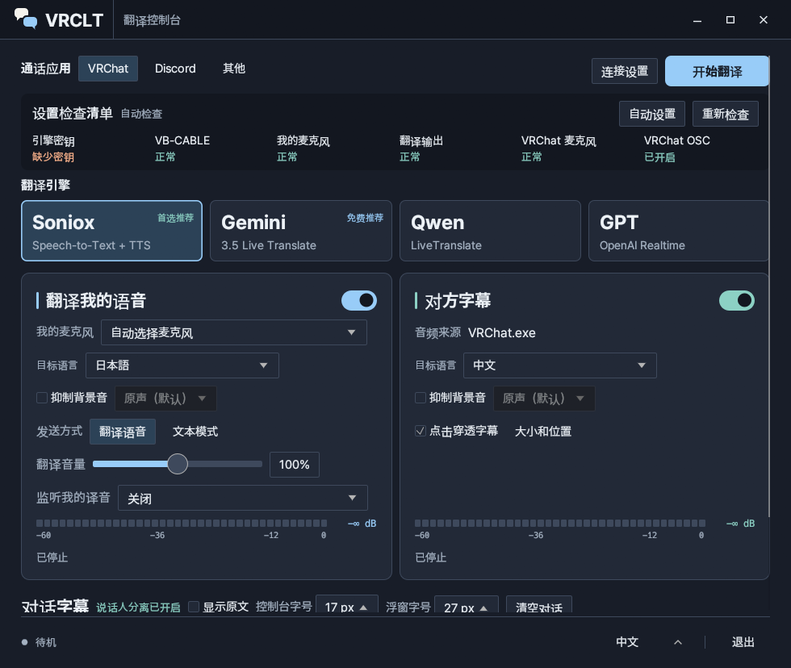
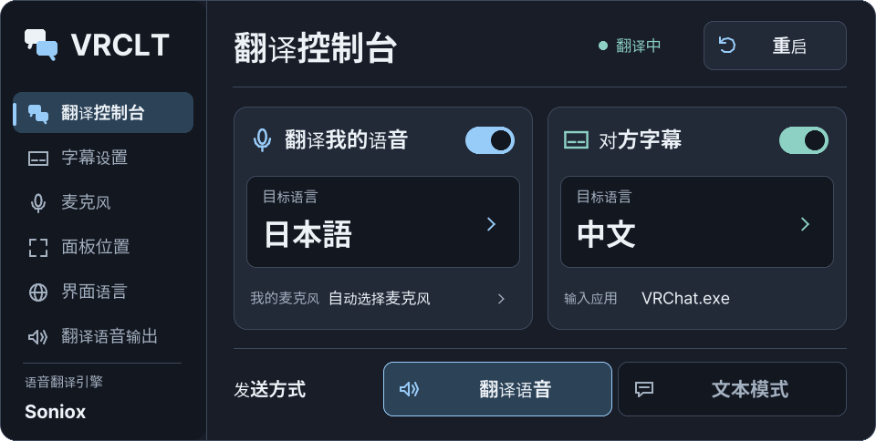

<picture>
  <source media="(prefers-color-scheme: dark)" srcset="docs/brand/logo-dark.svg">
  
</picture>

[English](README.md) | [한국어](README.ko.md) | [日本語](README.ja.md) | [简体中文](README.zh.md)

# VRCLT 2.0

适用于 VRChat 和 Discord 的 Windows 实时翻译应用。在同一个原生窗口中控制自己的语音翻译和对方发言的字幕。

**[下载 Windows 版](https://github.com/VRCLT/VRCLT/releases/latest)** | [发行说明](docs/releases/v2.0.0.md) | [指南](https://github.com/VRCLT/VRCLT/wiki)



## 快速开始

1. 退出旧版后运行 Windows x64 的 EXE。如果下载 ZIP，请解压并运行 `vrclt/vrclt.exe`。两种方式都会读取 `%LOCALAPPDATA%\vrclt\config.yaml` 中已有的设置和 API 密钥。
2. 打开连接设置，选择翻译引擎并输入 API 密钥。需要区分说话人时推荐 **Soniox**，想从免费额度开始可选 **Gemini 3.5 Live Translate**。也支持 **Qwen** 和 **GPT (OpenAI Realtime)**。费用和额度以各服务为准。
3. 选择麦克风、需要字幕的应用和目标语言。在设置检查清单中确认连接，按需使用自动设置，然后开始翻译。

如果 Windows 提示缺少 VCRUNTIME 或 MSVCP DLL，请安装 [Microsoft Visual C++ x64 运行库](https://aka.ms/vs/17/release/vc_redist.x64.exe)。

## 语音与文字

文字模式通过 OSC 向 VRChat 聊天框发送译文。文字模式和对方的字幕无需安装 VB-CABLE。发送翻译语音时，将输出设为 CABLE Input，在通话应用中选择 CABLE Output 作为麦克风。你也可以用耳机监听译音并调节音量。

## 字幕与 SteamVR

可显示原文、调整字号或清空对话。桌面字幕支持点击穿透。在 SteamVR 中看向手腕即可打开菜单，用握把移动面板，拖动字幕板下角即可调整大小。可在 SteamVR 的启动设置中切换自动启动。



## 音频选项

可为每个输入分别启用 DeepFilterNet3 (CPU) 或 Nemotron RE-USE (GPU) 来降低背景音。GPU 模型在首次使用时下载。使用 Soniox 时，还可以朗读示例文本来录制并保存自己的声音。

## 构建

在 Windows x64 上使用 Rust stable MSVC、Visual Studio C++ 工具、CMake 和 libclang。

```powershell
./scripts/build_native.ps1 -Test
./scripts/package_release.ps1 -SkipBuild
```

[MIT](LICENSE) | [Third-party licenses](licenses)
