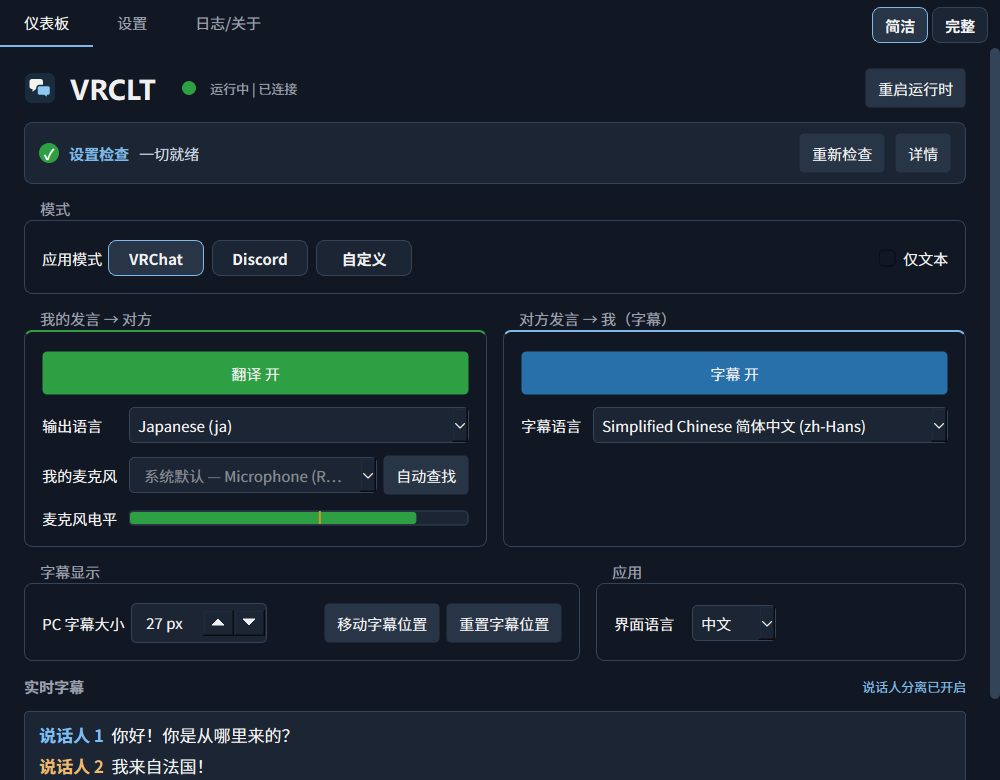
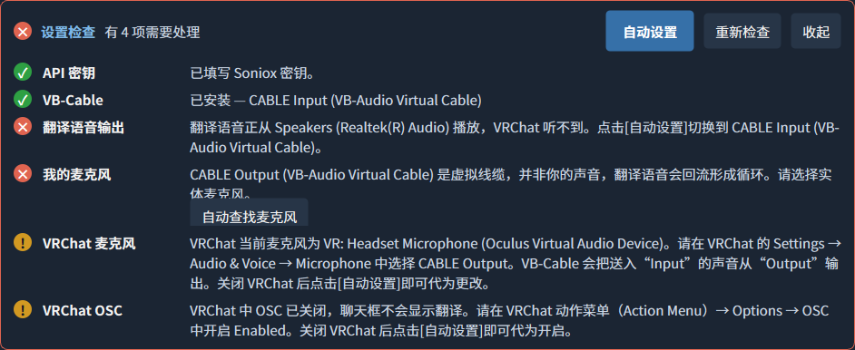
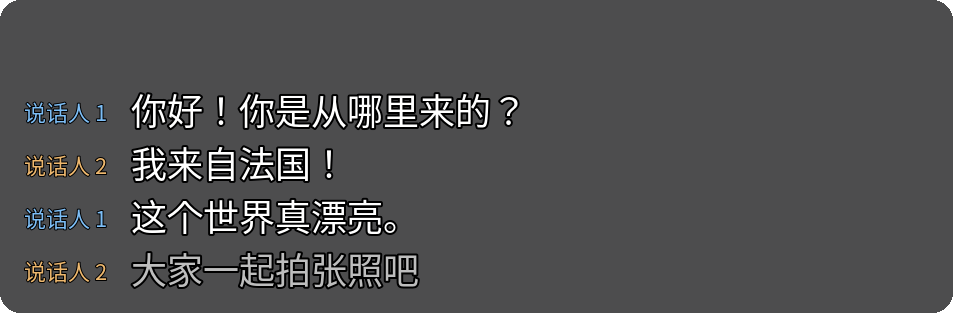
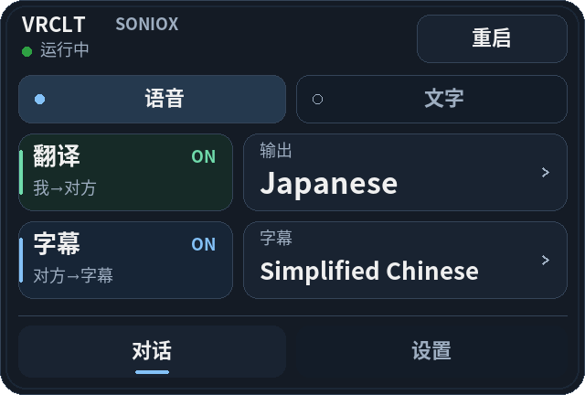
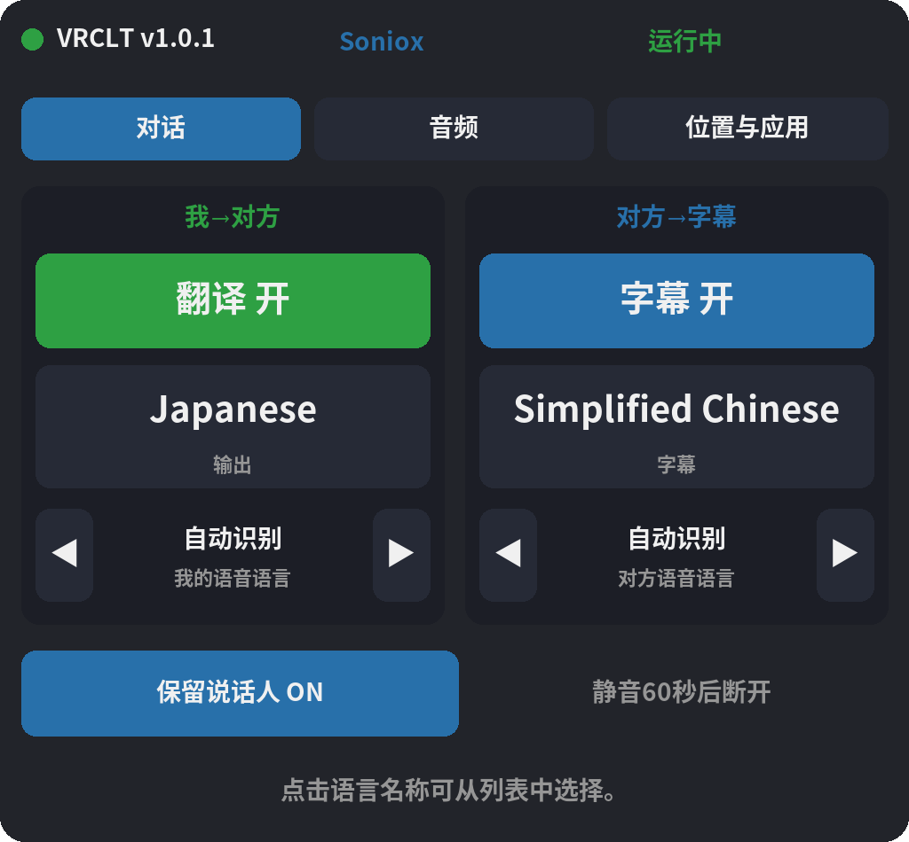

<h1>
  <picture>
    <source media="(prefers-color-scheme: dark)" srcset="docs/brand/logo-dark.svg">
    
  </picture>
</h1>

<a href="https://vrclt.github.io/zh/">官方网站</a>

### 说你的语言，让对方听到他的语言。

适用于 Windows 的 **VRChat** / **Discord** 实时语音翻译与实时字幕。

   

[English](README.md) · [한국어](README.ko.md) · [日本語](README.ja.md) · **中文**

 

  

[**⬇ 下载 VRCLT**](https://github.com/VRCLT/VRCLT/releases/latest) &nbsp;·&nbsp; [快速开始](#快速开始) &nbsp;·&nbsp; [详细文档](#文档)

## 为什么选择 VRCLT

<table>
<tr>
<td width="50%" valign="top">

### 🎙️ 你的声音，实时翻译

像平时一样说话即可。VRCLT 实时翻译，并把自然的翻译语音作为麦克风送入 VRChat 或 Discord，对方直接用自己的语言听到你。

</td>
<td width="50%" valign="top">

### 💬 实时字幕

其他人的话会以字幕显示在 SteamVR、桌面叠加层和应用中；使用可区分说话人的引擎时还会显示说话人编号。

</td>
</tr>
<tr>
<td width="50%" valign="top">

### ⚡ 一键设置

设置检查会告诉你缺少什么。**自动设置** 会完成音频路由、麦克风选择以及 VRChat 的麦克风和 OSC 设置；**自动安装 VB-Cable** 会替你运行官方安装程序。

</td>
<td width="50%" valign="top">

### 🥽 为 VR 打造

通过手腕菜单和 SteamVR 仪表板页面在 VR 中直接操作，字幕浮在眼前，还可以随 SteamVR 自动启动。

</td>
</tr>
<tr>
<td width="50%" valign="top">

### 💭 VRChat 聊天框

通过 OSC 把原文和译文发送到聊天框。仅文本模式保留你自己的声音，只添加翻译文字。

</td>
<td width="50%" valign="top">

### 🌐 四种引擎，70+ 种语言

Google Gemini Live、Qwen3.8 LiveTranslate、OpenAI gpt-realtime-translate 和 Soniox，可按价格、地区、语音和说话人区分来选择。

</td>
</tr>
</table>

## 快速开始

1. 从 [Releases](https://github.com/VRCLT/VRCLT/releases/latest) **下载并运行** `vrclt-v<version>-windows-x64.exe`，无需安装。
2. **填写 API 密钥。** 默认引擎为 Gemini。按照[各引擎的密钥获取步骤](https://github.com/VRCLT/VRCLT/wiki/%E8%8E%B7%E5%8F%96-API-%E5%AF%86%E9%92%A5)（含截图）获取密钥，然后粘贴到 **设置 → 翻译与语言**。
3. **其余交给设置检查。** 如果没有 VB-Cable，点击 **自动安装 VB-Cable**；关闭 VRChat 后点击 **自动设置**。
4. **启动 VRChat 开始说话。** 在仪表板或手腕菜单中开关翻译和字幕。

## 在 VR 中

  
&nbsp;&nbsp;

字幕浮在眼前，手腕菜单可切换翻译、字幕和语言，SteamVR 仪表板页面可调整语言、音频设备和面板布局。

## 文档

完整指南请见 [Wiki](https://github.com/VRCLT/VRCLT/wiki)：

| | |
| --- | --- |
| [安装](https://github.com/VRCLT/VRCLT/wiki/%E5%AE%89%E8%A3%85) | 要求、VB-Cable、首次启动、文件位置 |
| [获取 API 密钥](https://github.com/VRCLT/VRCLT/wiki/%E8%8E%B7%E5%8F%96-API-%E5%AF%86%E9%92%A5) | 获取 Gemini、Qwen、OpenAI、Soniox 密钥（含截图） |
| [翻译引擎](https://github.com/VRCLT/VRCLT/wiki/%E7%BF%BB%E8%AF%91%E5%BC%95%E6%93%8E) | 四种引擎对比：语言、语音、地区 |
| [使用方法](https://github.com/VRCLT/VRCLT/wiki/%E4%BD%BF%E7%94%A8%E6%96%B9%E6%B3%95) | 全部功能、应用模式、仪表板与设置、音频路由 |
| [VRChat 与 VR](https://github.com/VRCLT/VRCLT/wiki/VRChat-%E4%B8%8E-VR) | 聊天框、角色 OSC、SteamVR 字幕、手腕菜单、SteamVR 仪表板 |
| [故障排查](https://github.com/VRCLT/VRCLT/wiki/%E6%95%85%E9%9A%9C%E6%8E%92%E6%9F%A5) | 常见问题及解决方法 |
| [配置参考](https://github.com/VRCLT/VRCLT/wiki/%E9%85%8D%E7%BD%AE%E5%8F%82%E8%80%83) | `config.yaml` 的所有键 |
| [开发指南](https://github.com/VRCLT/VRCLT/wiki/%E5%BC%80%E5%8F%91%E6%8C%87%E5%8D%97) | 从源码运行、测试、构建与发布 |

## 致谢

- [Noto Sans CJK](https://github.com/notofonts/noto-cjk) 和 [Pretendard](https://github.com/orioncactus/pretendard): 多语言 UI 字体覆盖。
- [PySide6](https://doc.qt.io/qtforpython-6/): Windows 原生 UI。
- [OpenVR](https://github.com/ValveSoftware/openvr)、GLFW、PyOpenGL: SteamVR 叠加层渲染。
- [VB-Audio Virtual Cable](https://vb-audio.com/Cable/): 应用之间的音频路由。
