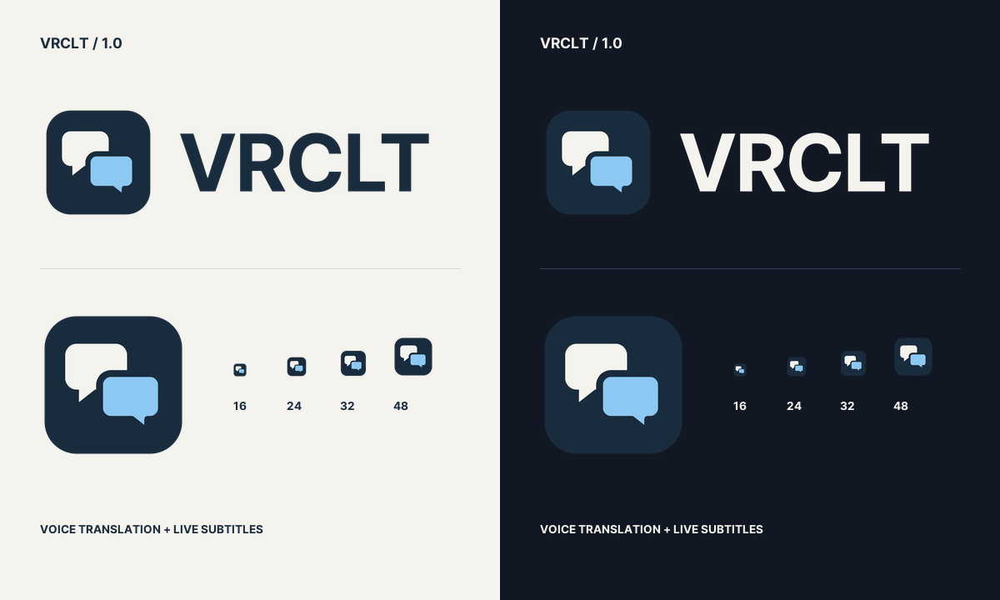

# VRCLT brand assets

Two offset speech bubbles represent a voice and its reply. The mark uses navy
(`#192C3D`), ivory (`#F5F3ED`), and blue (`#8CC8F2`), with no gradients or effects.



| Asset | Use |
| --- | --- |
| [logo-light.svg](logo-light.svg) / [PNG](logo-light.png) | Wordmark on light backgrounds; transparent |
| [logo-dark.svg](logo-dark.svg) / [PNG](logo-dark.png) | Wordmark on dark backgrounds; transparent |
| [icon-1024.png](icon-1024.png) | Square app/profile icon; transparent corners |
| [icon.svg](../../vrclt/assets/icon.svg) | Editable master mark |
| [icon.ico](../../vrclt/assets/icon.ico) | Windows app, taskbar, tray and executable icon |

README usage (automatically follows the reader's color scheme):

```html
<picture>
  <source media="(prefers-color-scheme: dark)" srcset="docs/brand/logo-dark.svg">
  
</picture>
```

Edit `vrclt/assets/icon.svg`, then regenerate all exports from the repository root:

```powershell
.\.venv\Scripts\python.exe scripts\make_icon.py
```

The wordmark uses the bundled [Pretendard JP Bold](../../vrclt/assets/fonts/LICENSE-PretendardJP.txt)
under the SIL Open Font License. SVG lettering is converted to paths, so the
logo does not depend on the viewer's installed fonts. The PNG logos are 1088 ×
320; the ICO includes 16, 20, 24, 32, 40, 48, 64, 128 and 256 px frames.

Rebuild the executable to embed the new Windows icon. SteamVR refreshes its
cached dashboard thumbnail from the bundled PNG when the dashboard starts.
